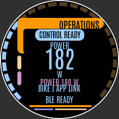
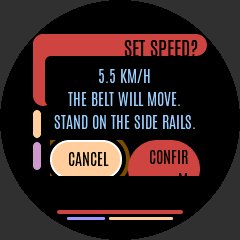
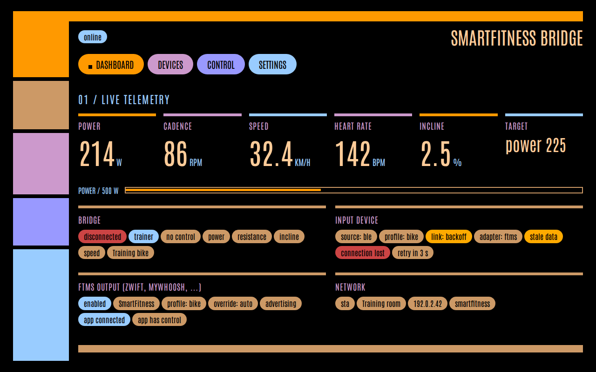
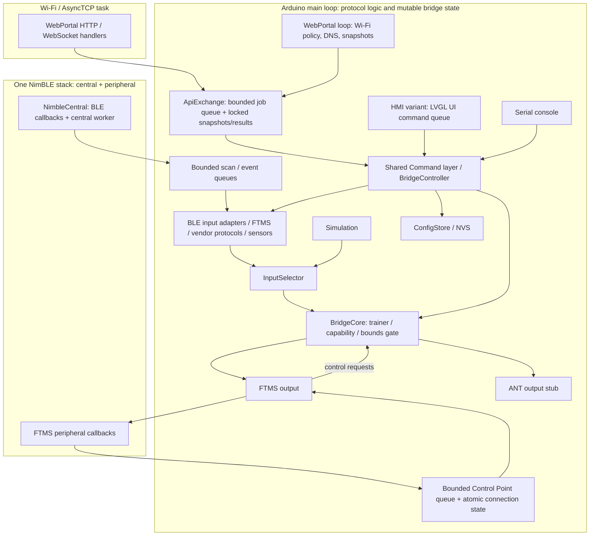

# ESP32 Smart Fitness Bridge

[](https://github.com/manuelh83/smartfitness-bridge/actions/workflows/ci.yml)

Firmware for ESP32-S3 boards that reads fitness equipment over BLE and forwards
measurements and supported trainer controls through Bluetooth FTMS. It is built in
two variants that share one core (see [Build variants](#build-variants)): a **web**
variant with Wi-Fi + web UI and an **HMI** variant with a local LVGL touch/knob UI
on the ELECROW CrowPanel 1.28" round rotary display.

> **License:** GPL-3.0-or-later (see [`LICENSE`](LICENSE)). The vendor protocols in
> `src/core/protocols/` and `include/core/protocols/` are ported from
> [`cagnulein/qdomyos-zwift`](https://github.com/cagnulein/qdomyos-zwift) (GPL-3.0),
> which makes the firmware a derivative work.

## Overview and project status

Implemented: real BLE input scanning/pairing, FTMS and sensor decoders, initial
qdomyos-zwift vendor ports, reconnect/backoff, stale-data handling, FTMS output,
Wi-Fi setup and web UI, a shared console/API command layer, and NVS configuration.
ANT output remains a stub; CPS/HRS output services and OTA are not implemented.

**Not verified on hardware.** Host tests and firmware compilation do not establish
real-device compatibility, radio coexistence, app interoperability, or safe physical
trainer operation. All supported-device entries are unverified on equipment.
The post-PR-#10 [main CI run](https://github.com/manuelh83/smartfitness-bridge/actions/runs/38030185653)
passed both host tests and firmware build; the badge above tracks CI.

## Build variants

| | Web variant | HMI variant |
|---|---|---|
| PlatformIO env | `esp32s3dev` (default) | `crowpanel128` |
| Build flag | `-DSF_VARIANT_WEB` | `-DSF_VARIANT_HMI` |
| Board | ESP32-S3 DevKitC-1 N16R8 | ELECROW CrowPanel 1.28" ESP32-S3 Rotary Display (ESP32-S3R8, 8 MB PSRAM, 16 MB flash) |
| User interface | Wi-Fi + web UI + REST/WebSocket API + Serial console | LVGL UI on the 240×240 round display (knob + touch) + Serial console |
| Extra libraries | ArduinoJson, AsyncTCP, ESPAsyncWebServer | LVGL, LovyanGFX, Adafruit NeoPixel |

Exactly one variant flag must be defined; `include/variant.h` stops the build with
`#error` otherwise. `src/main.cpp` contains the shared setup (config, BLE input,
simulation, `BridgeCore`, FTMS output, Serial console) and calls the variant hooks
`variant::begin()` / `variant::loop()`. Both variants use the same `Command`s and the
same `BridgeController`; the web variant renders its view model as JSON, the HMI
variant renders it with LVGL. The stored configuration (schema v3, including the
Wi-Fi fields) is identical; the HMI variant simply never starts Wi-Fi.

## User interfaces

Both variants share an **LCARS-inspired** palette, Antonio typography, swept
frames, pill controls and telemetry gauges. Existing commands and safety
confirmations are unchanged. These simulator/browser renders are **not
hardware-verified**; colours and readability need checking on the real IPS panel.





[Design system, HMI/web galleries and regeneration instructions](docs/hmi/README.md).

Source layout:

- `include/core/`, `src/core/` – shared core: BLE input, protocols, `BridgeCore`,
  FTMS output/profiles, `ConfigStore`/NVS, `Command` layer, `BridgeController` and
  the view model (`bridge_view_model.h`). It builds without any web or HMI source
  (checked by `make host-tests-core`).
- `include/variants/web/`, `src/variants/web/` – `WebPortal`, `ApiExchange`,
  `WifiPolicy`, JSON rendering (`web_json`) and the web app
  (`src/variants/web/assets/index.html`).
- `include/variants/hmi/`, `src/variants/hmi/` – LVGL screens (`hmi_ui`), the
  pure-C++ HMI model (`hmi_model`, strings in `hmi_strings`), board drivers
  (`hmi_hal`) and the pin header `board_crowpanel128.h`.
- `sim/` – headless LVGL host simulator that renders every HMI screen to PNG.

## Hardware and flashing

Targets: **ESP32-S3 DevKitC-1 N16R8** (web variant) and **ELECROW CrowPanel 1.28"
ESP32-S3 Rotary Display** (HMI variant). Both have 16 MB flash and 8 MB octal PSRAM
and use the Arduino framework, `qio_opi` memory mode and `default_16MB.csv`
partitions. Use the board's flashing connection (the CrowPanel has one USB-C port).

**Prerequisites:** Python 3.8+, Git, and PlatformIO Core (`pip install -U
platformio`), or the VS Code **PlatformIO IDE** extension, which bundles Core
(run the commands in its terminal). On Windows, a USB-UART driver (CP210x /
CH34x) is needed only when using the board's UART port.

### Build

```sh
git clone https://github.com/manuelh83/smartfitness-bridge.git
cd smartfitness-bridge
pio run -e esp32s3dev     # web variant
pio run -e crowpanel128   # HMI variant
```

- The first build downloads the toolchain, Arduino core, and pinned libraries; allow a few minutes.
- `scripts/embed_web_assets.py` runs automatically before compiling the web variant; no separate step is needed.
- Output files are in `.pio/build/<env>/`: `firmware.bin`, `bootloader.bin`, and `partitions.bin`. CI uploads them as `firmware-esp32s3dev` / `firmware-crowpanel128` artifacts.

### Flash and monitor

```sh
pio run -e esp32s3dev -t upload     # or: -e crowpanel128
pio device monitor -b 115200
```

- The DevKitC-1 has two USB ports; Serial output uses the native USB port labelled **USB** (`ARDUINO_USB_CDC_ON_BOOT=1`).
- If upload does not start, hold **BOOT**, press **RST**, release BOOT, and retry.
- Select ports with `--upload-port` / `--port`, e.g. `COM5` or `/dev/ttyACM0`.

Serial is **115200 baud** (USB CDC enabled); it prints boot/configuration and Wi-Fi
information.
ANT+ needs external hardware; see [hardware decisions](docs/hardware-decisions.md).

**Optional host tests:** `make host-tests` (requires `make` and `g++` with C++17; on
Windows, use WSL).

**Troubleshooting:** `platform = espressif32` is unpinned, while NimBLE-Arduino
1.4.3 requires Arduino core 2.0.x. If the build fails with NimBLE/`esp_` errors,
pin a 6.x `espressif32` platform version that ships Arduino core 2.0.17 (check the
[Dependency compatibility](#dependency-compatibility) section and platform release
notes for the exact version), then run `pio run -t clean` and rebuild with
`pio run -e esp32s3dev`.

## HMI variant (CrowPanel 1.28")

> **Not tested on hardware.** The HMI firmware compiles; layout and knob-only
> navigation are checked in the host simulator only. Display orientation, touch
> coordinates, encoder direction and LED ring order still need a real board.

### Board pins

All pins are in [`include/variants/hmi/board_crowpanel128.h`](include/variants/hmi/board_crowpanel128.h),
taken from ELECROW's official repository
[`Elecrow-RD/CrowPanel-1.28inch-HMI-ESP32-Rotary-Display-240-240-IPS-Round-Touch-Knob-Screen`](https://github.com/Elecrow-RD/CrowPanel-1.28inch-HMI-ESP32-Rotary-Display-240-240-IPS-Round-Touch-Knob-Screen)
(commit `63e407f`): factory firmware `RotaryScreen_1_28.ino`, the lesson examples and
the schematic *ESP32 Display-1.28-V1.0*. Summary: GC9A01 on SPI (SCLK 10, MOSI 11,
DC 3, CS 9, RST 14), backlight PWM GPIO 46, LCD power enable GPIO 1, CST816D touch on
I2C (SDA 6, SCL 7, INT 5, RST 13, address 0x15), encoder A 45 / B 42, button 41
(active low), 5 × WS2812 on GPIO 48. Items marked `TODO(verify)` in the header
(GPIO 2 5 V output enable, LED count/order) could not be confirmed beyond the
example code.

Drivers: LovyanGFX 1.2.7 (GC9A01, DMA flush), a small CST816D reader, and an
interrupt-driven quadrature decoder (4 quarter-steps per detent) read by the LVGL encoder input. LVGL 9.2.2 runs on the main
loop with one partial 240×40 RGB565 draw buffer (internal DMA RAM, PSRAM fallback).

### Navigation

| Input | Action |
|---|---|
| Turn knob | Move focus / change value / cycle dashboard metric |
| Press knob | Select, confirm a value |
| Hold knob (~0.4 s, LVGL long press) | Back |
| Tap | Select |
| Swipe right | Back (on the dashboard: previous metric) |
| Swipe left | Next dashboard metric |

Screens (same interactions as the web UI):

- **Dashboard** – arc gauge for the selected metric (power, cadence, speed, heart
  rate, incline, distance, time), target, connection/trainer/control state, machine
  profile and FTMS client state. Press opens the menu.
- **Devices** – start/stop scan, scan results (name, RSSI, adapter), pair/connect
  with optional adapter override (all adapters incl. `ifit-model-N` and WalkingPad
  cipher profiles), disconnect, unpair, simulation on/off.
- **Control** – target power/resistance/incline/speed. Values are set with the knob
  (fine steps) or the +/- buttons and applied with a knob press. Rejections show the
  `CommandResult` message. **Treadmill speed changes need an explicit Confirm**
  (Cancel is focused by default); the editor starts from the measured speed, and the
  bridge never starts the belt by itself. "Stop belt" sends speed 0.
- **Settings** – FTMS name (presets or on-screen keyboard), FTMS output on/off, FTMS
  output profile, ANT on/off (requires hardware), save, load, factory reset (two
  confirmations), restart, firmware version, brightness, screen timeout and LED
  ring. Brightness/timeout/LED ring are stored in a separate NVS namespace
  (`sfhmi`), so the shared configuration stays at schema v3.

The status refreshes at 5 Hz; UI callbacks only enqueue `Command`s that the main
loop executes. UI strings are centralised in `src/variants/hmi/hmi_strings.cpp`
(English; a German table can be added, but needs a font with umlauts).

### Simulator and screenshots

```sh
git clone --depth 1 --branch v9.2.2 https://github.com/lvgl/lvgl.git .cache/lvgl
make hmi-screenshots          # writes screenshots/*.png
```

The headless simulator renders every screen from the shared view model with fake
data and runs a knob-only walkthrough. CI uploads the PNGs as the
`hmi-screenshots` artifact.

### HMI limitations

- No Wi-Fi, web UI or REST/WebSocket API in this variant (Serial console stays).
- Only the built-in Montserrat fonts (ASCII); German umlauts need a custom font.
- Nothing is hardware-verified; see the pin TODOs above.

## Architecture



The diagram shows the web variant; in the HMI variant the Wi-Fi block is absent and LVGL runs on the main loop, pushing `Command`s into a bounded queue that the loop executes. Everything that runs on the Arduino `loop()` – the core, the adapters' protocol logic, the command executor – is single-threaded. BLE callbacks (NimBLE host task and the central worker task) and HTTP/WebSocket handlers (AsyncTCP task) only push into bounded, lock-protected queues; the loop drains them.

- `smartfitness::BridgeCore` (`include/core/bridge/bridge_core.hpp`): one canonical core header shared by firmware and host tests. Tracks disconnected, connected/read-only, trainer, and control-ready states.
- `BtDeviceAdapter`: equipment input interface. Implementations: `SimulatedDeviceAdapter`, `BleInputAdapter` (real BLE devices) and `InputSelector`, which forwards to the BLE input when a device is paired and BLE input is enabled, otherwise to the simulation.
- `BleInputAdapter` (`include/core/ble_input_adapter.h`): scanning, pairing, connection lifecycle, stale telemetry. It talks to the radio through the `CentralTransport` interface (`include/core/ble/central_transport.hpp`); `NimbleCentral` implements it on the firmware, `tests/host/fake_central.hpp` in host tests.
- Protocols (`include/core/protocols/`): pure C++ `SourceProtocol` implementations (FTMS, sensors, vendor ports) and the adapter registry.
- `AntOutput` / `FtmsOutput`: independent outputs. `AntOutput` is still a placeholder; `FtmsOutput` is a working BLE FTMS peripheral (see below).
- FTMS codec (`include/core/ftms/ftms_codec.hpp`): pure C++ encoding/decoding of FTMS characteristics, used by both the output and the FTMS input.
- `BridgeController` (`include/core/bridge_controller.h`): the variant-neutral command executor. The Serial console, the web API and the HMI all produce `Command` values (`include/core/bridge_commands.h`) and run them through `BridgeController::execute`; it also builds the status/scan/config view model (`include/core/bridge_view_model.h`).
- Web variant: `web_json` (`include/variants/web/web_json.h`) renders the view model as JSON; `ApiExchange` (`include/variants/web/web_api.h`) validates API JSON and hands jobs to the loop; `WebPortal` (`include/variants/web/web_portal.h`, firmware only) owns Wi-Fi, DNS/captive portal, mDNS and the HTTP/WebSocket server; `WifiPolicy` (`include/variants/web/wifi_policy.h`) decides AP/STA/fallback.
- HMI variant: `hmi::Model` (pure C++, host-tested) turns the view model into screen content and UI actions into `Command`s; `HmiUi` builds the LVGL screens; `hmi_hal` drives display, touch, encoder, backlight and LED ring.
- `ConfigStore` (`include/core/config_store.h`): configuration persisted through a `ConfigBackend` (NVS on the firmware, memory in host tests). See [Persistent configuration](#persistent-configuration).
- `smartfitness::FtmsRoles` (`include/core/bridge/ftms_roles.hpp`): independent input/output role flags. `ftms.input` now means "use the paired BLE device as input (auto-connect)".

## First setup walkthrough

1. Flash the board and open Serial at 115200. With no stored home-network SSID,
   it opens the WPA2 SoftAP **`SmartFitness-XXXX`** (`XXXX` is the last two MAC
   bytes) with default password **`smartfitness`**.
2. Join that network. Captive-portal DNS and OS probe redirects should open the
   UI; if not, open **`http://192.168.4.1/`** (or the AP IP printed on Serial).
3. Open **Settings**, enter the home Wi-Fi SSID and password, and choose a new AP
   password (8–63 printable ASCII characters). Click **Save**, wait for the result,
   then **Restart**. Console equivalent:
   ```text
   wifi HomeNetwork your-home-passphrase
   ap-pass your-new-ap-passphrase
   save
   restart
   ```
   Use the web UI for SSIDs containing spaces. `wifi <ssid>` sets an open network;
   `wifi-clear`, then `save` and `restart`, restores AP-only operation.
4. On the home network, open **`http://smartfitness.local/`** (mDNS) or the station
   IP. If STA fails to connect within **20 s** at boot or after link loss, the AP
   is added (AP+STA); STA keeps retrying. After STA has been connected for **2 min**
   and no AP clients remain, the fallback AP closes. Policy is checked once/second.

**Security warning:** change the shared default password before normal use.
The HTTP API has **no authentication or TLS**; anyone on the AP/home network can
control, pair, erase settings, or restart the bridge. Do not port-forward it or
use an untrusted network. POST requests require `Content-Type: application/json`,
even with no body. A supplied `Origin` must be `http://smartfitness.local`, the
current STA IP, or the SoftAP IP (optional `:80`); foreign/null origins are rejected.
No CORS access is enabled. This blocks browser CSRF, **not** clients already on
your network; there is no API token. WebSocket upgrades also reject foreign origins.
Passwords are never returned by API snapshots/results. Serial prints only the
factory-default AP password; custom passwords are shown as `(custom)`, and the
home Wi-Fi password is never logged. Credentials are stored in NVS.
AP passwords must be 8–63 printable ASCII characters. Invalid stored AP passwords
fall back to the default while preserving other valid settings; a failed SoftAP
start is logged and retried with the default. Change that default before normal use.
Wi-Fi/AP edits (including factory reset) require a restart to change the running network.

## Pairing walkthrough

1. Wake the equipment, enable its pairing mode, and disconnect competing apps.
2. Open **Devices → Scan**; select a result by name/address, RSSI, services, and
   detected adapter. Optionally override the adapter, then choose **Pair**.
3. Pairing saves the source and enables BLE input immediately. Watch the Dashboard
   link state and metrics; a successful pairing command means “connecting”, not
   that the equipment has already connected. **Connect**, **Disconnect**, **Unpair**
   and **Use simulation** are also available on Devices.

Console equivalent (substitute the actual scan address/type):

```text
scan 10
scan-results
pair aa:bb:cc:dd:ee:ff auto random
status
disconnect
connect
sim
```

Full syntax: `pair <addr> [adapter|auto] [public|random]`. When type is omitted,
the scan result supplies it; for an explicit type with automatic detection use
`auto` in the adapter position. An explicit registered adapter also allows pairing
an address not in the current scan list; detection without a scan result cannot work.
`sim` disables BLE input in RAM without forgetting the pairing; `connect` selects
the saved BLE source again. `save` persists that input toggle.

### Connection lifecycle and stale data
- The paired device is connected on boot when BLE input is enabled. Connect attempts time out after 15 s; failures and link loss reconnect with exponential backoff (1 s … 30 s).
- If a connected device delivers no data for 5 s, its telemetry is marked stale and invalidated (outputs stop reporting the metrics). If no data arrives for 20 s, the link is dropped and reconnected.
- Stale treadmill telemetry also disables treadmill controls until fresh data
  restores readiness. The FTMS input handshake never automatically sends
  Start/Resume to a treadmill, cross-trainer or rower. Bike initialization sends
  it only with confirmed bike identity, not an ambiguous bike fallback.
- The peer currently connected to the FTMS output is never offered in scan results and never connected to as an input.

## Supported devices and new protocols

See [supported devices](docs/supported-devices.md) for the complete adapter table,
match rules, metrics, controls, attribution, and test status. Only the listed
qdomyos-zwift ports exist; this is not support for its entire device catalogue.

To add a protocol:
1. Implement pure C++ `SourceProtocol` in `include/core/protocols/` and `src/core/protocols/`:
   `plan()` declares reads/subscriptions, `onRead()`/`onNotify()` decode bytes,
   `control()`/`tick()` queue writes drained by `takeWrite()`; advertisement-only
   inputs use `onAdvertisement()`.
   Long handshakes can request bounded `startupTimeoutMs()` grace. Dynamic GATT
   discovery is opt-in through `ConnectPlan`; explicitly allowlist write UUIDs
   and receive the resolved endpoint through `onWriteEndpoint()`.
2. Add an id (`[a-z0-9_-]`, at most 16 characters), matcher, factory, and priority
   to `kProtocols` in `src/core/protocols/registry.cpp`. Highest matching priority wins;
   avoid broad vendor matches stealing unrelated devices from standard protocols.
3. Add host tests with representative byte samples and malformed/truncated packets
   in `tests/host/test_ble_input.cpp`, and add the source to the Makefile.
4. For ports, retain a GPL attribution header with upstream project, source file,
   revision, and derived behavior; label synthetic vectors versus hardware captures.

## Using with apps

### Zwift / MyWhoosh

Connect the source first, then pair the bridge's advertised name (default
`SmartFitness Bridge`) as an FTMS power/cadence source and controllable trainer.
Use only one app/client at a time. ERG requires source power control; simulation
grade requires incline control. Read-only sources do not become controllable trainers.
App compatibility remains **not verified on hardware**.

### Treadmill apps

Connect the treadmill source before pairing the bridge with **Zwift Run** for
speed/incline/heart-rate telemetry. Telemetry compatibility does **not** guarantee
that Zwift can control belt speed. **Kinomap** and **QZ** control behavior depends
on the client, source capabilities, and firmware; hardware interoperability is
unverified. Read-only treadmills remain read-only.

### nRF Connect smoke test

1. Run `sim` (not `scan`) on Serial, and ensure `ftms-output on` and `trainer on`.
2. Scan for service `0x1826`, connect to `SmartFitness Bridge`, and subscribe to
   Indoor Bike Data `0x2AD2`. Expected simulation bytes:
   `44 02 C4 09 A0 00 96 00 78` (25 km/h, 80 rpm, 150 W, 120 bpm).
3. Enable Control Point `0x2AD9` indications; write `00` to request control
   (response `80 00 01`), then `05 C8 00` for 200 W (`80 05 01`).
   Simulation telemetry should change to 200 W.
4. Run `trainer off`; a power write `05 FA 00` should return `80 05 05`
   (Control Not Permitted). Restore `trainer on`; disconnect when done.

For a controllable treadmill source, select automatic/treadmill output, reconnect
the client after a profile change, and subscribe to Treadmill Data `0x2ACD` instead.
Enable Control Point indications and write Request Control `00` → `80 00 01`,
then target **8 km/h** `02 20 03` → `80 02 01` if the source accepts it.
**This speed command can cause real belt movement.** Test only with a clear belt
and a person at the physical controls; the safety key and physical stop remain
primary. Start/Resume never starts the belt. Disconnects and stale telemetry do
not send stop or speed commands: do not rely on the bridge as an emergency stop.
Treadmill Start/Resume returns Operation Failed (`80 07 04`) because there is no
safe source start primitive.

### Garmin

Do not assume the fenix 6/6 Pro can consume/control this FTMS output.
[HD-002](docs/hardware-decisions.md#hd-002-garmin-watches-eg-fenix-6-pro-and-bluetooth-ftms)
records the CPS/HRS output and multi-client work needed for recording, and the
external ANT+ FE-C path needed for trainer control.

## Serial console
The Serial monitor (115200 baud, newline-terminated) accepts the same commands as the web UI:

| Command | Effect |
|---|---|
| `help`, `status` | Help and a one-line status (includes `input=ble/sim link=… paired=… stale=1`) |
| `scan [seconds]` | BLE scan (1–60 s, default 10 s); without BLE input support it connects the simulation |
| `scan-stop`, `scan-results` | Stop scanning / list results (address, name, RSSI, detected adapter) |
| `pair <aa:bb:cc:dd:ee:ff> [adapter\|auto] [public\|random]` | Persist source and enable BLE input; explicit adapter permits an unscanned address |
| `connect`, `disconnect`, `unpair` | Reconnect the paired device, disconnect, forget the pairing |
| `sim` | Use the simulated device as input (150 W, 80 rpm, 25 km/h, 120 bpm) |
| `power <W>`, `resistance <%>`, `incline <%>`, `speed <km/h>` | Control through the `BridgeCore` gate; prints the rejection reason |
| `trainer on/off` | Toggle simulated trainer detection only (does not promote real equipment) |
| `ant on/off` | Enable/disable the ANT stub; does not transmit ANT+ |
| `ftms-input on/off` | Select paired BLE input / simulation; independent of output |
| `ftms-output on/off` | Enable advertising / disconnect client and stop advertising |
| `ftms-name <name>` | Set 1–20 printable ASCII characters; spaces are allowed |
| `ftms-profile <auto\|bike\|treadmill\|cross-trainer\|rower>` | Select output profile; `auto` follows input, unsupported output types fall back to bike; `save` persists |
| `wifi <ssid> [password]`, `wifi-clear`, `ap-pass <password>` | Wi-Fi settings (save + restart to apply) |
| `save`, `load`, `factory-reset`, `restart` | Persistence and reboot |

`status` includes `ftms-out(advertising=…,client=…,control=…)`: whether the FTMS output is advertising, whether a BLE client is connected, and whether that client has been granted control via Request Control.
`input-profile`, `output-profile` and `ftms-profile` show the active input type,
effective output type and configured override respectively.
It also includes `dropped(scans=…,events=…,notifications=…,commands=…)` for BLE
transport queue overflow. These cumulative counters are available as
`input.dropped` in `/api/status`; scan-result-list overflow remains the separate
`dropped` field in `/api/scan/results`.
Lines are newline-terminated, limited to 96 characters, and case-sensitive.
Use literal `on` or `off`, not `on/off`. Settings are RAM edits until `save`,
except pairing/unpairing, which persist their own changes immediately.

## Web interface
### Using the UI
The single-page app (`src/variants/web/assets/index.html`, web variant only, plain HTML/JS/CSS, gzipped into flash at build time by `scripts/embed_web_assets.py`, no external resources) has four tabs:
- **Dashboard:** live power, cadence, speed, heart rate, incline, control target, input/link/stale state, active input profile, effective output profile, trainer/control state and FTMS output client state (WebSocket, ≤ 4 Hz).
- **Devices:** pairing walkthrough – 1. *Scan* (put the equipment into pairing mode and disconnect it from other apps first), 2. pick a result (name, RSSI, detected type, services), optionally change the adapter type, 3. *Pair*. The pairing is saved immediately and reconnected on boot. *Disconnect*, *Connect* and *Unpair* are on the same page; *Use simulation* switches to the simulated device.
- **Control:** set target power/resistance/incline/speed; the result (`applied`, `not a trainer`, `unsupported control`, …) is shown.
- **Settings:** FTMS output name, on/off and machine-profile override, ANT on/off (requires hardware, see `docs/hardware-decisions.md`), Wi-Fi credentials, AP password, save, factory reset, restart and firmware version.

## REST / WebSocket API

HTTP runs on port 80. POST bodies are JSON objects (max. **1024 bytes**, nesting
limit 2, unknown keys rejected); an empty body is treated as `{}`. All POSTs
require `Content-Type: application/json` (an optional charset parameter is allowed)
and a trusted Origin if supplied, including bodyless endpoints. Chunked transfer
encoding, incomplete bodies and embedded NUL characters are rejected.
The HTTP handlers never touch the core: a syntactically valid request is queued
for the main loop and answered with **`202 {"id":n}`**. This is not command success:
execution/validation can subsequently fail. Multi-setting requests execute in a
fixed order and stop at the first failure, **without rollback**.

| Method | Path | Body | Effect |
|---|---|---|---|
| GET | `/api/status` | – | Status snapshot (same as WebSocket `status`) |
| POST | `/api/scan` | `{"seconds":10}` or `{"action":"stop"}` | Start (1–60 s) or stop a scan |
| GET | `/api/scan/results` | – | `{"type":"scan","scanning":…,"devices":[{"address","addressType","name","rssi","services","adapter","connectable"}],"adapters":[…]}` |
| POST | `/api/pair` | `{"address":"aa:bb:cc:dd:ee:ff","adapter":"auto","addressType":"random"}` | Persist and connect; adapter/addressType optional; explicit adapter allows unscanned address |
| POST | `/api/unpair` | `{}` | Disconnect and forget the paired device |
| POST | `/api/connect`, `/api/disconnect`, `/api/simulate` | `{}` | Connect paired device / disconnect / use the simulation |
| POST | `/api/control` | `{"control":"power","value":200}` | `power`, `resistance`, `incline` or `speed` through the core gate |
| GET | `/api/config` | – | Settings (passwords are never returned; `wifiPasswordSet` instead) |
| POST | `/api/config` | `{"ftmsName":"My Bridge","ftmsOutputProfile":"auto","ftmsOutput":true,"ftmsInput":true,"ant":false,"simulatedTrainer":true,"wifiSsid":"HomeNetwork","wifiPassword":"your-home-passphrase","apPassword":"your-new-ap-passphrase","save":true}` | Any subset; order: profile, name, output, input, ANT, simulated trainer, Wi-Fi, AP password, save |
| POST | `/api/factory-reset`, `/api/restart` | `{}` | Factory reset / reboot |
| GET | `/api/result?id=1` | – | Poll queued command result; see below |
| GET | `/` | – | Gzipped HTML/JS/CSS app (`200`, not JSON) |
| GET | `/generate_204`, `/hotspot-detect.html`, `/connecttest.txt`, `/ncsi.txt` | – | Captive-portal `302` redirect to AP IP |
| WS | `/ws` | – | Server sends `status`, `scan`, `config`, `result`; client messages ignored |

Config types: `ftmsName`, `ftmsOutputProfile`, SSID, and passwords are strings;
`ftmsOutputProfile` accepts `auto`, `bike`, `treadmill`, `cross-trainer` or `rower`.
Toggles and `save`
are booleans. `wifiSsid:""` clears SSID/password. `wifiPassword` requires
`wifiSsid`; omit it to retain the old password, or use `""` for an open network.
Omitted optional fields are ignored; null fields are ignored except
`ftmsOutputProfile`, which must be a valid profile string when supplied.
`{}` or only `{"save":false}` is rejected
as “no settings given”. See the schema table for string limits; the command layer
requires a nonempty FTMS name (1–20), although the persisted schema permits empty.
`/api/save` and `/api/load` are **not HTTP routes**, even though the shared parser
recognizes those command names; use `{"save":true}` at `/api/config` or Serial.

### Response examples and result polling

All mutation endpoints use the same acceptance/result envelope:

```json
{"id":1}
```

`GET /api/result?id=1` returns **202** while pending:

```json
{"type":"result","id":1,"done":false}
```

Then **200** when execution is done (also sent on `/ws`):

```json
{"type":"result","id":1,"done":true,"ok":true,"message":"control: applied"}
```

An execution failure is still HTTP 200, for example:

```json
{"type":"result","id":1,"done":true,"ok":false,"message":"control: disconnected"}
```

Results occupy a **16-entry ring**, not a timed retention window; later requests
evict older entries. Poll promptly. Missing/unknown/evicted ids return **404**:
`{"error":"unknown or expired request id"}`.

| HTTP status | Meaning / example |
|---|---|
| 202 | Accepted job `{"id":1}`, or pending result above |
| 400 | Parse/type/value/unknown-field error, e.g. `{"error":"expected a JSON object"}` |
| 403 | POST Origin is not a trusted device origin |
| 413 | `{"error":"request body too large"}` |
| 415 | Missing/non-JSON POST Content-Type |
| 500 | Body allocation failed; command is not submitted |
| 503 | Eight-job queue full: `{"error":"busy; try again"}` |
| 404 | Unknown route `{"error":"not found"}` or unknown result id |

Unknown GET hosts while AP is active may instead receive a captive redirect.
API JSON responses use `Cache-Control: no-store`.

### Snapshot examples

`GET /api/status` (**200**); metric values are numbers rounded to one decimal,
or `null` when invalid. Example disconnected snapshot:

```json
{
  "type":"status","version":"0.3.0","state":"disconnected",
  "telemetry":{"power":null,"cadence":null,"speed":null,"heartRate":null,"incline":null,"distance":null,"elapsed":null},
  "deviceName":"","trainer":false,"canControl":false,"controls":[],"target":null,
  "input":{"source":"simulation","profile":"bike","bleAvailable":true,"link":"idle","protocol":"","stale":false,
    "scanning":false,"error":"","reconnectAttempts":0,"nextAttemptMs":0,"autoConnect":false,"paired":null,
    "dropped":{"scans":0,"events":0,"notifications":0,"commands":0}},
  "ftmsOutput":{"enabled":true,"profile":"bike","override":"auto","name":"SmartFitness Bridge","advertising":true,"client":false,"control":false},
  "ant":true,"unsaved":false,
  "network":{"mode":"ap","ssid":"SmartFitness-XXXX","ip":"192.168.4.1","hostname":"smartfitness.local","stations":1}
}
```

`version` is the build version (`0.3.0` by default); actual network/link values vary.
`input.profile` is the active input machine type; `ftmsOutput.profile` is the
effective output and `ftmsOutput.override` is the configured selection.
States: `disconnected`, `connected/read-only`, `trainer`, `control-ready`.
`target` when set is `{"control":"power","value":200}`.
`input.paired` when set is
`{"address":"aa:bb:cc:dd:ee:ff","addressType":"random","name":"Bike","adapter":"ftms"}`.

`GET /api/scan/results` (**200**); abbreviated to one device/adapter:

```json
{
  "type":"scan","scanning":true,"bleAvailable":true,"dropped":0,
  "devices":[{"address":"aa:bb:cc:dd:ee:ff","addressType":"random","name":"Bike","rssi":-60,
    "connectable":true,"adapter":"ftms","services":["0x1826"]}],
  "adapters":[{"id":"ftms","label":"FTMS fitness machine","controllable":true,"advertisementOnly":false}]
}
```

`GET /api/config` (**200**):

```json
{
  "type":"config","version":"0.3.0","ftmsName":"SmartFitness Bridge",
  "ftmsOutput":true,"ftmsOutputProfile":"auto","ftmsInput":false,"ant":true,"antRequiresHardware":true,
  "simulatedTrainer":true,"wifiSsid":"","wifiPasswordSet":false,
  "apPasswordDefault":true,"unsaved":false
}
```

**Passwords are never returned** by API snapshots/results: only
`wifiPasswordSet` and `apPasswordDefault` flags are exposed.

### WebSocket messages

Connect to `ws://smartfitness.local/ws` (or the IP). An initial `status` snapshot
is sent on connection; subsequent `status` messages are sent at most every 250 ms
when clients can accept writes. `scan` and password-free `config` are sent on change, checked every 1000 ms
(a completed API job also triggers an immediate snapshot refresh).
`result` is sent when a queued job finishes. These use the JSON shapes above.
All broadcasts check client count and write availability to avoid flooding slow
clients. Unsent scan/config changes are retained (latest snapshot) for a later loop;
command results remain retrievable through `/api/result` even if not broadcast.
GET snapshots are updated independently of WebSocket congestion.
Early GET/WS snapshots can be `{}` before
the main loop first publishes them. The socket is server-to-client only.

## Persistent configuration
Settings changed on the console are edited in RAM; `status` ends with `unsaved=1` while they differ from the stored configuration.

| Command | Effect |
|---|---|
| `save` | Writes the configuration to NVS. Nothing is written when the stored record would not change. |
| `load` | Reloads the configuration from NVS (discarding unsaved edits) and applies it. |
| `unpair` | Disconnects, clears the paired device and persists only that change immediately. |
| `factory-reset` | Disconnects, erases the `sfbridge` NVS namespace and restores the defaults. |

On boot the stored configuration is loaded before the outputs are enabled, so `ftms-name`, the output-profile override, the ANT/FTMS toggles, the simulated trainer flag and the pairing survive a reboot. A missing, corrupt or unknown-version record falls back to the defaults (the record is replaced on the next `save`).

NVS layout: namespace `sfbridge`, one blob key `config` (max. 256 bytes), little endian:

| Field | Size | Notes |
|---|---|---|
| magic | 2 | `'S' 'F'` |
| schema version | 1 | `3`; decoder accepts `1`, `2` and `3` |
| `antEnabled`, `ftms.input`, `ftms.output`, `simulatedTrainer` | 4 × 1 | Each `0` or `1`; defaults: `1`, `0`, `1`, `1` |
| `ftmsName` | 1 + n | ≤ 20 printable ASCII bytes; default empty means `SmartFitness Bridge` |
| `pairedDeviceName` | 1 + n | ≤ 32 printable ASCII bytes, default empty; pairing sanitizes/truncates names |
| `pairedAdapterId` (v2) | 1 + n | ≤ 16 bytes, lowercase `[a-z0-9_-]`; default empty; pairing requires a registered, nonempty id |
| `wifiSsid` (v2) | 1 + n | ≤ 32 bytes; no bytes below `0x20` or equal to `0x7f`; UTF-8 bytes allowed; default empty (AP only) |
| `wifiPassword` (v2) | 1 + n | Empty for open network or 8–63 printable ASCII bytes; default empty |
| `apPassword` (v2) | 1 + n | 8–63 printable ASCII bytes, never empty; default `smartfitness` |
| paired source valid | 1 | `0` or `1`, default `0` |
| paired source address type | 1 | `0`–`3`; console/API accepts public (`0`) or random (`1`) |
| paired source address | 6 | Address bytes in display order; invalid source requires type/address all zero |
| `ftmsOutputProfile` (v3) | 1 | After source address, before CRC: `0` auto (default), `1` bike, `2` treadmill, `3` cross-trainer, `4` rower |
| CRC-32 | 4 | Little endian; over all preceding bytes, reflected polynomial `0xEDB88320`, initial/final XOR `0xffffffff` |

Each text field is a one-byte length followed by exactly that many bytes (no NUL).
The v3 record is **26 + all six text lengths** bytes: maximum **252 bytes**,
below the backend's **256 B** limit. Decoder rejects bad CRC/magic/versions,
truncation, invalid booleans/text/source, oversize records, and trailing bytes.

**v1/v2 → v3 migration:** v1 contains the same first two text fields and
paired-source tail, but omits adapter id, SSID, Wi-Fi password and AP password.
Loading preserves legacy fields and fills missing fields with defaults. Both v1
and v2 migrate to output profile `auto`. Migration does not write during boot;
the next `save` serializes v3 and replaces the legacy blob. A legacy source with
an empty adapter id is not auto-connected: scan and pair it again.

Write avoidance compares serialized bytes with the stored record. Unchanged
`save`, pair, or unpair operations do not rewrite the blob. Missing storage is
treated as defaults, so saving untouched defaults need not create a record.
Invalid storage is retained only for comparison so a later save replaces it.
Pairing persists only the source/name/adapter and enabled input; unpair persists
only removal of the pairing, leaving other RAM edits unsaved.

Writes/erases happen from explicit console/web commands on the main loop, not
periodically or in BLE/HTTP callbacks. `factory-reset` erases the namespace and
restores RAM defaults, disconnects the source, and applies output settings; it
does **not** reboot. Restart to apply default Wi-Fi/AP settings. CRC detects
corruption, not tampering or encryption.

## FTMS output (Bluetooth LE)
`FtmsOutput` is a NimBLE-Arduino GATT server (firmware only; the transport is compiled under `#ifdef ARDUINO`, so host tests need no BLE stack). It advertises the Fitness Machine Service UUID `0x1826`, FTMS service data (machine available, effective output type), and the configured name (`ftms-name`, default `SmartFitness Bridge`, max 20 ASCII characters).

The shared machine-profile names are `auto|bike|treadmill|cross-trainer|rower`.
`auto` uses the active input profile: vendor adapters declare their machine type,
and FTMS input derives it from discovered data characteristics and FTMS service
data rather than treating every `0x1826` source as a bike. Simulation and sensor
sources default to bike. An explicit output-profile override is saved in schema
v3; it changes presentation, not the source's controls or safety limits.
For ambiguous FTMS subscriptions, the first valid data notification fixes the
input profile; other machine-data UUIDs are ignored. An explicit supported FTMS
advertised type can change that selection and clears old metrics/freshness.

Bike and treadmill output are implemented. **Full Cross Trainer Data and Rower
Data output are deferred to follow-up work**, including their profile-specific
features, control semantics, codecs and hardware/app validation. These input
profiles remain visible as `cross-trainer`/`rower`, while their effective output
is explicitly shown as `bike` fallback; selecting those overrides also falls
back to bike. This is not a transparent reproduction of the source GATT server.

The GATT database is stable and includes both Indoor Bike Data and Treadmill
Data characteristics. Only the effective profile's data is notified. A profile
change disconnects the client, invalidates its Request Control grant and queued
session commands, and re-advertises with the new machine-type service data.
The database itself does not change, so no Service Changed indication is
required; disconnect/re-advertise refreshes presentation instead. Reconnect,
read features again, and request control again.

| Characteristic | UUID | Properties | Content |
|---|---|---|---|
| Fitness Machine Feature | `0x2ACC` | read | Profile/capability-derived. Bike: cadence, inclination, HR, power; targets: inclination (+ bike simulation), resistance, power. Treadmill: mandatory instantaneous speed plus optional inclination, HR, distance and elapsed time; targets: speed/inclination only when supported. Bit 0 means average speed, not instantaneous-speed support, and is not set |
| Indoor Bike Data | `0x2AD2` | notify | Speed (0.01 km/h), cadence (0.5 rpm), power (W, sint16), heart rate (bpm). A field and its flag are present only when the core marks the metric valid. Sent on change (at most every 250 ms) and at least once per second while a client is connected |
| Treadmill Data | `0x2ACD` | notify | Valid speed (0.01 km/h), inclination and ramp angle, HR, optional distance and elapsed time; treadmill profile only. Same notification cadence as bike data |
| Training Status | `0x2AD3` | read, notify | Bike: Idle without a device, Manual Mode when connected. Treadmill: Idle until valid nonzero speed, Manual Mode while moving |
| Supported Speed Range | `0x2AD4` | read | Core bounds 0.00 … 100.00 km/h, step 0.01 km/h; tighter input limits are enforced by the adapter, not yet exposed here |
| Supported Inclination Range | `0x2AD5` | read | −20.0 … 25.0 %, step 0.1 % |
| Supported Resistance Level Range | `0x2AD6` | read | 0.0 … 100.0, step 1.0 (one unit = one normalized percent) |
| Supported Power Range | `0x2AD8` | read | 0 … 2000 W, step 1 W |
| Fitness Machine Control Point | `0x2AD9` | write, indicate | Opcodes below; every write is answered with `0x80, opcode, result` |
| Fitness Machine Status | `0x2ADA` | notify | Sent for acknowledged changes (reset, start, stop/pause, target speed/incline/resistance/power, simulation parameters), as applicable to the profile |

Common Control Point opcodes: Request Control `0x00`, Reset `0x01`, Set Target
Inclination `0x03` (sint16, 0.1 %), Start/Resume `0x07`, and Stop/Pause `0x08`
(`0x01` stop, `0x02` pause). Treadmill adds Set Target Speed `0x02` (uint16,
0.01 km/h). Bike supports Set Target Resistance `0x04` (uint8 0.1, sint16 0.1
also accepted), Set Target Power `0x05` (sint16 W), and Set Indoor Bike Simulation
Parameters `0x11` (grade mapped to incline). Treadmill output rejects power,
resistance and bike simulation; an override does not grant unsupported controls.
Other opcodes return Not Supported (`0x02`); wrong lengths return Invalid
Parameter (`0x03`).

Control flow: NimBLE callbacks (BLE task) only push writes and connect/disconnect events into a small lock-protected queue. `FtmsOutput::loop()` drains it, requires Request Control before any other command (otherwise Control Not Permitted `0x05`), and routes set commands through `requestControl()` → `BridgeCore::routeControl`. Core results map to FTMS result codes: Applied → Success `0x01`, Unsupported → Not Supported `0x02`, InvalidValue → Invalid Parameter `0x03`, AdapterRejected → Operation Failed `0x04`, Disconnected/NotTrainer/NoAdapter → Control Not Permitted `0x05`. A BLE disconnect revokes control, drops queued writes from that session and restarts advertising. `ftms-output off` disconnects the client and stops advertising; `ftms-output on` resumes advertising.

### Limitations
- Treadmill Start/Resume **never starts the belt** and returns Operation Failed
  (`0x04`): there is no safe source start primitive. Bike Start/Resume remains an
  acknowledgement without starting the source. Treadmill
  Stop/Pause sends a gated speed-zero command when supported; failure or lack of
  speed control returns Operation Failed (`0x04`), not a fictitious successful
  stop. Bike Stop/Pause remains an acknowledgement without stopping the source.
  Reset releases the output control grant; it does not reset the source or clear
  the core target.
- Disconnect and stale-data handling never send stop/speed commands. Use the
  equipment's physical stop and safety key; bridge control is not a safety system.
- Treadmill packets fit within **20 bytes**, even with speed, inclination/ramp
  angle, HR, distance and elapsed time, so no More Data fragmentation is needed.
  FTMS-supplied distance and elapsed time are decoded and forwarded when actually
  present and valid. Vendor-source totals are not synthesized; elapsed time is
  never invented from connection uptime. No energy fields are emitted.
- Bike simulation parameters map only grade to incline; wind speed, rolling
  resistance and drag are not forwarded.
- Only one client is served at a time (advertising stops while connected). No bonding/security, no Cycling Power or Heart Rate services.
- The Feature characteristic follows the connected device's capabilities; clients usually read it once on connection, so connect the source device before pairing the app.
- Changing the name while a client is connected applies on the next advertising cycle.

## Trainer gating
Commands require a connected device, trainer detection, a supported control, a finite value in range, and adapter acceptance. A command cannot promote a device to trainer mode. Rejected commands never replace the accepted target.

Normalized units: speed in km/h, cadence in rpm, power in watts, heart rate in bpm, incline in percent, and resistance in percent. Core safety bounds are speed 0–100 km/h, incline −20–25%, resistance 0–100%, and power 0–2000 W. Real adapters must additionally enforce their equipment's tighter bounds.

## Limits and resources

| Resource | Current limit |
|---|---|
| NimBLE connections | Compile-time maximum **3**: one BLE input, one FTMS output client, one spare |
| Source selection | One source, not sensor aggregation; Keiser is advertisement-only |
| FTMS clients | **One**; advertising stops while connected |
| Scan results | 24 deduplicated entries |
| Central queues | 24 scan reports; 32 events (lifecycle events can evict notifications); 8 worker operations |
| Protocol write outbox | 16 pending GATT writes |
| FTMS Control Point queue | 8 writes, 20 bytes per write; full queue drops a write |
| API | 8 jobs; up to 2 processed/loop; 16 cached results; body ≤ 1024 bytes |
| Serial | 96-character command; at most 64 input characters consumed/loop |
| Configuration | One NVS blob ≤ 256 B; maximum valid v3 record 252 B |

NimBLE host callbacks/central worker and AsyncTCP handlers hand off through
bounded queues/locked caches; the bridge and codecs run cooperatively in the
main loop (5 ms delay). Central connect/discovery work uses a worker task with
a 6144-byte stack pinned to core 1. Queue overflow is not a delivery guarantee;
watch scan `dropped`, `input.dropped` and input `error` and poll results promptly.
Lifecycle events can evict queued notifications, so notification saturation
cannot hide a disconnect; existing read/connection event ordering is preserved.
Stop/disconnect requests flag pending connection work
for cancellation even if the command queue is full; rejected queue submissions
are counted and reported instead of silently succeeding.
`scan-stop` during connection setup cancels that attempt and automatic reconnect;
stopping an ordinary scan does not disconnect a ready device. Queued scan starts
are invalidated by a later stop.
NimBLE 1.4.3 still performs synchronous connection and GATT operations in the
worker. The connect timeout is 5 s (NimBLE's wait can add roughly 1 s); cancellation
is checked between discovery/read/subscribe steps. Individual GATT calls retain
NimBLE's own timeout limits, so stopping is not guaranteed to be immediate.
An established link can be disconnected to release pending GATT operations.

Wi-Fi modem sleep is deliberately **enabled** (`WiFi.setSleep(true)`) for
BLE/Wi-Fi coexistence on one radio; do not disable it as a latency workaround.
Radio performance and heap headroom under simultaneous scanning, FTMS and Wi-Fi
traffic need hardware measurement.

The [post-merge firmware build](https://github.com/manuelh83/smartfitness-bridge/actions/runs/38030185653/job/114149294707)
reported **62,916 / 327,680 B RAM** and **1,139,789 / 6,553,600 B flash**.
These are linker/build figures for that revision, **not** total board capacity,
runtime free heap or PSRAM usage. The board has 16 MB flash / 8 MB PSRAM; the
partition and allocations determine usable capacity. Web assets are gzipped
into flash; no separate filesystem upload is required.

There is no API authentication/TLS or BLE bonding/security. ANT enablement is
only a stub setting, not ANT transmission.

## Development

From the repository root:

```sh
make host-tests
pio run -e esp32s3dev
pio run -e crowpanel128
make hmi-screenshots LVGL_DIR=.cache/lvgl   # optional, needs an LVGL v9.2.2 checkout
```

Host tests use GNU Make and g++, compile C++17 with
`-Wall -Wextra -Werror -pthread`. `make host-tests` runs three steps:
`host-tests-core` links the core alone (no web or HMI sources), `host-tests-all`
runs the full suite (core, `BridgeController`/view model, web JSON/API, HMI model),
and `variant-guard` checks that `include/variant.h` rejects zero or two variant flags.
They cover core gating/disconnects, FTMS codec/control flow, config round trips,
v1 migration/CRC/validation/write avoidance, BLE registry/codecs/reconnect/stale
handling, console/API validation, POST origin/content-type checks, fragmented-body
validation/allocation-error decisions, AP-password fallback, lifecycle priority
and queue rejection, and Wi-Fi policy. They do not run the
real NimBLE/AsyncTCP/Wi-Fi transports. There is no separate documentation linter.
Hardware verification is still required for rapid A→B switching and cancellation
during BLE connection/discovery, full-queue command handling on FreeRTOS,
fragmented HTTP requests/heap exhaustion, slow/multiple WebSocket clients, and
SoftAP failure/fallback with simultaneous BLE/Wi-Fi activity. Host regressions
verify the state machines and pure validation helpers, not radio/transport timing.

PlatformIO runs `scripts/embed_web_assets.py` before building: it converts
`src/variants/web/assets/index.html` into deterministic gzip bytes in `include/generated/web_assets.h`,
rewriting only on content changes. It can also be invoked with
`python3 scripts/embed_web_assets.py`. Generated headers (`include/generated/`)
and `.pio/` are gitignored; edit the HTML, not the generated header.

### Dependency compatibility

| Dependency | Version / rationale |
|---|---|
| Arduino-ESP32 core | **2.0.17** compatibility baseline; supplied by the resolved `espressif32` platform, not directly pinned |
| NimBLE-Arduino | **1.4.3**, pinned; 1.x APIs match core 2.0.17, NimBLE 2.x needs core 3.x |
| ESPAsyncWebServer | **3.12.1**, pinned; async HTTP/WebSocket handling with bounded main-loop handoff |
| AsyncTCP | **3.5.0**, pinned; networking backend for ESPAsyncWebServer |
| ArduinoJson | **7.4.3**, pinned; web variant API JSON validation and rendering |
| LVGL | **9.2.2**, pinned; HMI variant UI (also used by the host simulator) |
| LovyanGFX | **1.2.7**, pinned; HMI variant GC9A01 display driver, builds on core 2.0.17 |
| Adafruit NeoPixel | **1.12.3**, pinned; HMI variant optional LED ring |

`platform = espressif32` is **unpinned**; the library pins do not freeze the core
or entire toolchain. Host tests use the vendored ArduinoJson header in
`tests/host/third_party`. CI installs PlatformIO **6.2.0** on Python 3.12 and runs
host tests, the `esp32s3dev` and `crowpanel128` builds (firmware artifacts) and the
HMI simulator screenshots for pushes/PRs to `main`. Do not interpret
green CI as hardware validation.

### Extension contract
- Prefer `SourceProtocol` for additional BLE protocols, using the existing input
  lifecycle; implement `BtDeviceAdapter` for a new kind of input.
- Emit telemetry from the cooperative `loop()` context. BLE callbacks on other tasks must queue events for that loop (as `FtmsOutput` does); the core is not thread-safe.
- Subclass `AntOutput` or `FtmsOutput` and override publish/loop methods to implement transport encoding and scheduling. Call the base publish methods to keep snapshots current, and use `requestControl()` for received protocol controls. Override `clearControlTarget()` (calling the base) to clear queued transport targets when disconnected or capabilities are lost; a snapshot target is only meaningful when `hasControlTarget()` is true.
- The attached adapter and outputs must outlive the core. Reattachment removes old callbacks and clears device state.

## Roadmap

- Hardware validation: first setup, every source protocol, real trainer controls,
  reconnect/persistence, nRF Connect, Zwift/MyWhoosh and BLE/Wi-Fi load tests.
- API authentication and access protection.
- CPS/HRS outputs and multi-client support for Garmin recording.
- ANT+ FE-C using a USB ANT+ stick/USB host transport (HD-001).
- More qdomyos-zwift device ports with attribution and byte-sample tests.
- OTA updates and CI release builds with downloadable firmware.

## License and attribution

This firmware is **GPL-3.0-or-later**; [`LICENSE`](LICENSE) contains the GNU GPL v3
text. Vendor protocol code is derived from
[`cagnulein/qdomyos-zwift`](https://github.com/cagnulein/qdomyos-zwift) by Roberto
Viola and contributors (GPL-3.0). Port headers retain upstream paths (no upstream
commit revision is recorded); see the
[supported-device attribution table](docs/supported-devices.md).
Redistribution must comply with the GPL, including corresponding source obligations.
[HD-005](docs/hardware-decisions.md#hd-005-gpl-30-licensing-for-qdomyos-zwift-ports)
records this decision. Dependency licenses remain their own; the vendored
ArduinoJson license is in `tests/host/third_party/ArduinoJson/LICENSE.txt`.
