# User interfaces

The **CrowPanel 1.28" round 240×240 HMI** (`crowpanel128`, LVGL 9.2.2)
and **self-contained web app** (`esp32s3dev`) share navy surfaces, sport-specific
accents and the areas **Training**, **Connections**, and **System**.
The HMI uses contextual screens for the rotary knob rather than shrinking the
web layout. The web implementation is described in [Web design](#web-design).

The HMI display, rotary encoder (turning/direction), and knob press have been tested
and work on the real CrowPanel with the preceding firmware. This redesigned HMI
still requires hardware validation. Gallery images are simulator renders with fixed
sample data, not photographs; the web UI remains unverified on hardware. Touch
accuracy, colours, small text, IPS contrast, frame rate, heap/PSRAM headroom and
readability still require checks on the real panel. Commands, safety confirmations,
API contracts, BLE and FTMS behavior are unchanged. The web UI adds explicit speed
confirmation and a second factory-reset confirmation.

## HMI design system

The tokens below are the design specification. HMI implementation:
[`lcars_theme.h`](../../include/variants/hmi/lcars_theme.h) and
[`lcars_theme.cpp`](../../src/variants/hmi/lcars_theme.cpp).
Depth matches the web UI, kept cheap for LVGL on the round 240×240 panel:

- **Sky:** each screen has a `Sky` (`#10283C`) band at the top that fades into
  `Black` over 112 px.
- **Gradients:** header bands and buttons use their token as the top colour and
  fade to a darker shade of it. The header band also has a hairline edge.
- **Glow:** on the training dashboard, a soft radial glow in the sport accent
  rises from the bottom edge. The arc has two faint halo arcs behind it.
- **Dithering:** the panel is RGB565 and LVGL 9 does not dither gradients, so
  the large sky and glow areas are pre-dithered images instead of LVGL
  gradients. Without this they would show visible bands.
- **Decor:** sky, glow and halos are flagged `lcars::Decor`, so the simulator's
  layout and overlap checks ignore them.
- **Icons:** Training, Connections, System and Back in the menu carry the same
  icons as the web navigation. The dashboard header shows the sport icon next to
  its name; if a long name does not fit, the icon is dropped before the text is
  truncated.

Icons come from `src/variants/web/assets/index.html`.
[`scripts/gen_hmi_icons.py`](../../scripts/gen_hmi_icons.py) rasterises them into
A8 images in `src/variants/hmi/icons/hmi_icons.c`, which LVGL recolours. The
same file holds the dithered sky (RGB565) and glow (A8) textures. Run
`.venv/bin/python scripts/gen_hmi_icons.py` after changing an icon; `--check`
verifies the file is up to date.

| Token | Colour | Role |
|---|---|---|
| Background | `#07111D` | Screen and negative space |
| Surface | `#0D1E2E` | Buttons, readouts and chart |
| Border | `#2B465D` | Fine outlines and inactive gauge |
| Text | `#F1F6FC` | Primary text |
| Muted | `#9BB5CA` | Units and supporting labels |
| Selection | `#204560` | Focused action |
| Blue | `#53B9FF` | Navigation and adjustment accents |
| Alert | `#78313B` | Failure, disconnect, stale data, stop and destructive actions |
| White | `#FFFFFF` | Keyboard/knob focus border; web `:focus-visible` outline |

The historical `lcars` filenames and colour aliases remain internal compatibility
names, not the visual specification. Training accents match the web sport palette.

### Typography and licence

**Antonio Regular (weight 400)** is a tall condensed sans-serif by Vernon Adams,
licensed under the **SIL Open Font License 1.1**. The original variable font and
[`OFL.txt`](../../assets/fonts/OFL.txt) are committed in `assets/fonts/`.
Source: [Google Fonts Antonio](https://github.com/google/fonts/tree/main/ofl/antonio).
HMI fonts subset `U+0020–007E` and `U+00A0–00FF`, including digits and German
umlauts. HMI text sizes are **16 and 20 px**; the **48 px** readout subsets digits
and numeric punctuation only. Fonts use 4-bit antialiasing, uncompressed LVGL
bitmaps. Training uses LVGL's built-in Montserrat at 12/14/16/20/28/40 px.
Numbers shrink to fit reserved lanes rather than collide with adjacent values.
Very large measurements use scientific notation; missing/non-finite readings show `--`.
The web uses system fonts instead of embedding Antonio; no font request is made.

Menus are uppercase; training labels retain mixed case. Editable names and
underlying identifiers retain their values. Light text sits on dark surfaces.
Error indicators include text, not colour alone. English is the firmware default;
German translations cover the new navigation and training labels, with the existing
English fallback for untranslated diagnostics.

### Shapes and states

- HMI: a compact dark header band identifies the sport or current page.
  The continuous training arc runs uninterrupted across the top.
- Web: see the separate responsive card design below.
- Navigation/actions: dark fills, rounded corners, left-aligned labels.
  Ordinary HMI action targets are at least 36 px tall; touch adjustment helpers
  are 44×44 px. The existing compact text keyboard is also operable by knob;
  use the larger preset pills when possible.
- Data: large central digits, unit underneath, two labelled secondary readouts;
  a continuous rounded sport-coloured arc indicates the visual reference range.
- Signal strength (HMI): a 4-bar pictogram (`lcars::signalBars`) replaces the
  numeric RSSI in scan results (light on dark, left of the label) and device
  details. Bars lit: ≥ −60 dBm 4, ≥ −70 dBm 3, ≥ −80 dBm 2, else 1;
  unlit bars stay visible at 30 % opacity so the level reads by shape.
- Focus: brighter selection with a white outline, including `:focus-visible`.
  On the HMI the knob cursor is a 2 px white inner border plus a 2 px white
  ring 1 px outside the focused pill/roller/keyboard (light text colour while
  editing). Lists, button rows and the roller keep 3 px of padding
  (`lcars::FocusRing`) so the ring is never clipped. Keyboard keys use the
  inner border only. The dashboard, whose whole circle is the only knob
  target, draws no ring on the panel edge.
  Pressed: distinct blue surface. Disabled: dimmed and non-actionable.
- HMI red alert colours the header band for disconnected/stale status,
  command rejection, speed confirmation and factory reset. The scrollbar and
  telemetry gauge retain their normal colours. Stop/destructive action pills
  keep their semantic red; rejected-command toasts also use the alert surface.
  No blinking is required.
- HMI status snapshots remain at **200 ms (≤5 Hz)**; scan refresh remains 1 Hz.
  Web respects `prefers-reduced-motion`.

### Round-display adaptation

The dashboard and adjustment gauges use a 224 px diameter, an 8 px stroke,
rounded ends and a 270° sweep. The two secondary readout centres are at
**x=52 and x=188**. Their lanes are at most 46 px wide; simulator geometry
assertions require **at least 8 px clearance** from text ink to the arc's
inner edge across all six profiles, both languages and extreme values.
The example values generally leave more space.
Lists are centred inside the circle; corners are not
used for essential labels/actions. Long device names also wrap in the detail body;
the header title is a single line inside the header band (long titles end in
an ellipsis). Dashboard readouts reserve independent lanes; the adapter roller
shows three complete rows, and the adjustment +/- helpers stay inside the
gauge ring.
Scrollable lists and the adapter/model roller have a **left curved scrollbar**:
a muted 4 px track and blue 6 px thumb follow the left circular edge.
Thumb length represents the visible fraction (minimum 8° for very long content);
position represents the clamped scroll offset. It updates with swipe scrolling,
encoder focus/roller movement and content/layout changes. LVGL's straight
scrollbar is disabled. Non-scrollable content hides the arc completely:
dashboard and short confirmation dialogs leave the left side without a scrollbar.
Lists settle their layout before scrolling to focused pills and preserve
the existing encoder focus order. The outside of each simulator PNG is masked
grey to show the physical round boundary. The rectangular web frame uses a
sidebar on desktop and a navigation pill row on narrow phones.

## Navigation

The HMI main menu contains exactly **Training / Connections / System**.
Training opens live values, target control or history. Connections opens the
fitness device, output configuration or receiving app/display. System contains
firmware information, brightness, timeout, LED ring and Save; **Advanced** contains
simulation, trainer simulation, Load, Restart and Factory reset.
No Wi-Fi/HTTPS controls are added to the HMI.

- **HMI knob:** dashboard turn cycles metrics; press opens the navigation menu.
  Turn moves focus; press selects. In adjustment, turn changes the value and
  press applies. Hold goes back/cancels. Speed changes retain confirmation;
  factory reset retains two confirmations, each initially focused on Cancel.
  Every list screen ends in a **Back** entry, so the knob alone always reaches
  the previous screen; the menu's Back returns to the live dashboard. Because
  the encoder scrolls a list only by moving the focus, every list region stays
  reachable: unsupported rows remain focusable read-only pills and a leading
  info block taller than the focus reveal is itself a focus stop.
- **HMI touch:** tap pills/readout, swipe right to go back; swipe left/right
  on the dashboard cycles metrics. +/- adjust values; Apply uses the same
  confirmation path. Names retain presets and the on-screen keyboard.
- **Web:** Training, Connections and System tabs work on desktop/phone.
  Use Tab/Shift-Tab to move focus and Enter/Space to activate controls; tab
  navigation also supports arrow keys and Home/End. Fields retain labels,
  status/result announcements and the original asynchronous result flow.
  Stop and destructive actions remain visibly distinct.

### Training metrics and history

The HMI uses the **input machine profile**, so an output-format override does not
mislabel the physical device. A source/profile change resets the primary selection.

| Profile | Default primary | Secondary values |
|---|---|---|
| Indoor bike | Power | Cadence / distance |
| Treadmill | Speed | Incline / distance |
| Rower | Stroke rate | Power / distance |
| Cross trainer | Resistance level | Step rate / distance |
| Step climber | Step rate | Elevation gain / steps |
| Stair climber | Step rate | Floors / steps |

Turn/swipe cycles available metrics; the secondary lanes avoid repeating the
selected primary. Distance converts core metres to kilometres; elapsed time uses
minutes:seconds. Cadence units distinguish rpm, rowing strokes/min and steps/min.
Missing, stale or disconnected data never appears as a fresh measurement.
The arc scale is a visual reference, not the device's supported control range.

**Training → History** records the profile's default primary, independently of the
currently selected live metric. A fixed ring buffer stores at most 301 samples
(under 4 KiB for the model) and always covers the whole session: once it is full
it halves its resolution by merging adjacent samples, so the sampling interval
doubles (1 s, 2 s, 4 s, …) instead of discarding the session start. Nothing is
persisted. Source/address/address-type/adapter/profile changes clear it.
Invalid data and even brief stale/disconnect intervals break the line; missed
time is not backfilled and survives the merging as a gap. The full-width chart
buckets the samples by time into at most 145 columns, auto-scales the Y axis to
the session minimum and maximum and rescales the X axis to the session length;
both axes are labelled (metric with unit, observed range, elapsed time ticks).
The bounded buffer collects on all screens; reboot starts an empty history.
There are no invented Pause/Start commands. Existing speed-zero Stop belt and
Cancel-first speed/reset confirmations retain their command paths.

## HMI gallery

| Dashboard: bike | Dashboard: treadmill | Knob navigation |
|---|---|---|
| 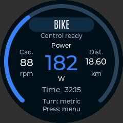 | 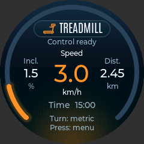 | 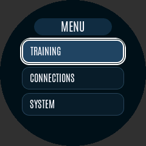 |

| Rower | Cross trainer | Step / stair climber |
|---|---|---|
| 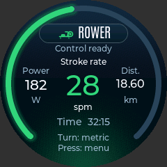 | 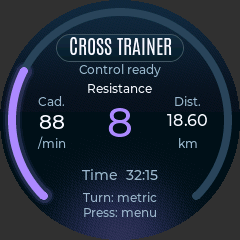 | 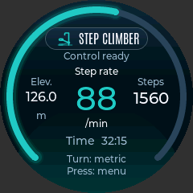 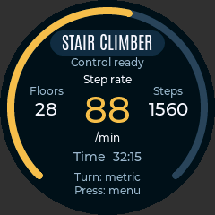 |

| Training | Connections | Advanced |
|---|---|---|
| 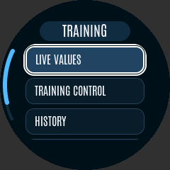 | 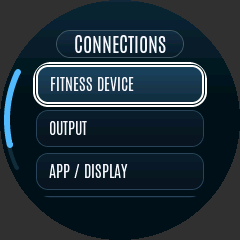 | 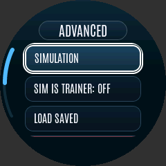 |

| Five-minute history with a data gap | Empty history | German training |
|---|---|---|
| 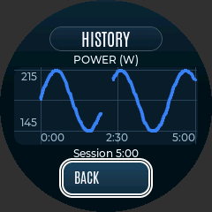 | 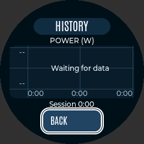 | 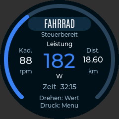 |

| Devices / scan | Focused scan results | Device details |
|---|---|---|
| 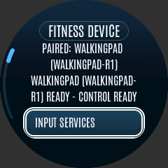 | 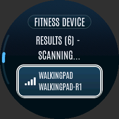 | 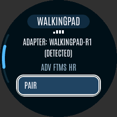 |

| Adapter/model selection | Treadmill controls | Speed adjustment |
|---|---|---|
| 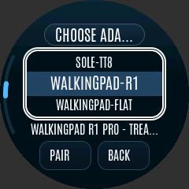 | 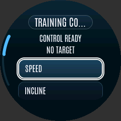 | 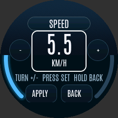 |

| Red-alert speed confirmation | Bike controls | Power adjustment |
|---|---|---|
| 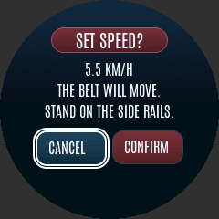 | 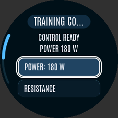 | 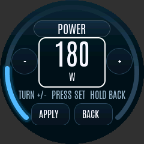 |

| Settings | Scrolled settings / knob focus | Name presets |
|---|---|---|
| 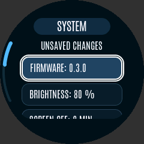 | 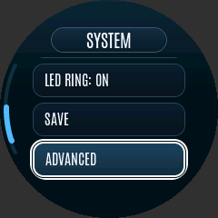 | 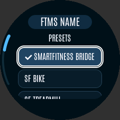 |

| Keyboard | Reset: first confirmation | Reset: second confirmation |
|---|---|---|
| 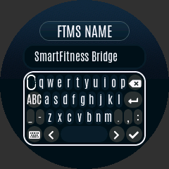 | 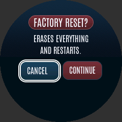 | 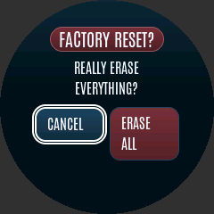 |

| Rejected command | Disconnected/stale |
|---|---|
| 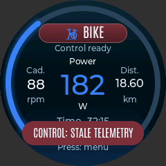 | 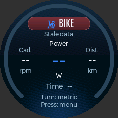 |

| Long devices list: top | Middle | Bottom |
|---|---|---|
| 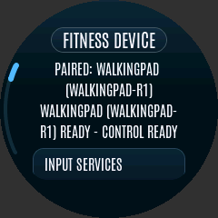 | 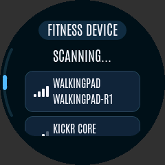 | 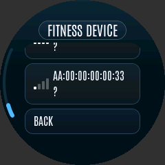 |

| Input: advertised services | Subscribed notification | Failed subscription |
|---|---|---|
| 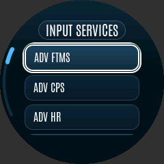 | 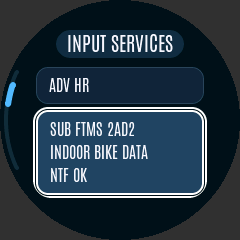 | 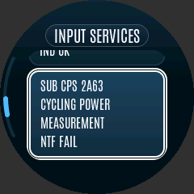 |

| Pending subscription | Output services | Optional service without data |
|---|---|---|
| 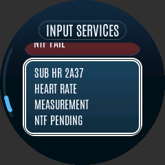 | 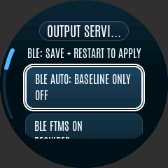 | 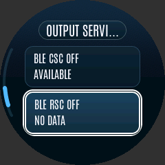 |

| BLE service change pending restart |
|---|
| 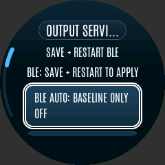 |

### Service diagnostics and settings

**Connections → Fitness device → Input services** shows the paired device's
advertised UUIDs (`ADV`) and subscription attempts (`SUB`). Each subscription names its service,
characteristic and mode (`NTF` notification / `IND` indication), with textual
`OK`, `FAIL` (alert) or `PENDING` state. These are diagnostics,
not controls. Every row is a focusable, wrapping pill so the knob can scroll
through all entries without touch. Scan-device details also show advertised
services. Unknown UUIDs retain a shortened identifier.

**Connections → Output → Output services** offers Auto and BLE FTMS/CPS/HR/CSC/RSC pills.
FTMS is mandatory; the other four are independent selections. Each pill
distinguishes on/off from active, available or no-data state. The shared
controller validates each request; a rejected selection shows its reason in
the command-result toast. Selected services use a brighter surface, off services a muted surface, and
enabled services without available data alert red; activity is a separate
readout, not the selection colour. Unavailable off services remain readable by
knob but cannot be enabled. Auto is mask `0`, meaning **baseline FTMS only**, not all
services; explicit bits are FTMS `1`, CPS `2`, HR `4`, CSC `8`, RSC `16`.
Changes use the shared `SetOutputServices` command with transport `ftms`.
Save persists the selection. BLE service changes use a boot-only GATT topology;
an explicit save-and-restart hint is always visible and the live
`restartRequired` flag adds a definite warning.
**Connections → Output → Output** cycles **BLE FTMS → Off** on CrowPanel;
ANT+ is included only when the live transport is available.
Receiver status is separate under **Connections → App / display**.
Enablement alone does not imply live data.
New service strings include English and German translations.
See [HD-009](../hardware-decisions.md#hd-009-selectable-ble-services-and-ant-output-channels)
for schema migration and boot-frozen GATT decisions.

## Web design

The web UI is one offline-capable HTML/CSS/JS asset, gzipped into flash. It uses
system fonts, inline SVG, a navy background (`#07111D`), card surfaces (`#0D1E2E`),
fine borders (`#2B465D`) and explicit text alongside status colours.
Subtle radial/linear gradients give the page, sidebar and cards depth; the live
card adds a soft glow in the profile accent behind the arc. The sidebar shows the
SmartFitness logo and line icons for Training, Connections and System. Each
profile has a two-tone equipment icon in an accent-tinted tile. On desktop the
first content card starts level with the first navigation item, and Training
control stretches to the live card height with **Apply** anchored at its bottom.

Training uses the effective output profile (or input profile when output is off):

| Profile | Accent | Primary | Left / right secondary |
|---|---|---|---|
| Indoor bike | Blue | Power | Cadence / distance |
| Treadmill | Orange | Speed | Incline / distance |
| Rower | Green | Stroke rate | Power / distance |
| Cross trainer | Violet | Resistance | Step rate / distance |
| Step climber | Turquoise | Step rate | Elevation gain / steps |
| Stair climber | Gold | Step rate | Floors / steps |

Secondary values are not repeated below the arc. Four other measurements have
individual cards; remaining reported fields are under **More measurements**.
Missing/non-finite, disconnected or stale readings show `–`, never invented zeros.
The arc uses a visual reference scale, not a claimed hardware control range.
Its fill is clamped; the numeric reading is not.

The history records at most 301 samples, at most once per second, over five minutes
in the current browser. It resets for a changed device/source/profile and does not
join gaps across stale data or disconnects. It draws a confirmed-target series only
when its control and units correspond to the primary metric (a resistance
percentage is not plotted against a raw resistance level). Reloading clears history.

Compact control uses only the existing power/resistance/incline/speed API and
advertised capabilities. Numeric input, accepted target and actual measurement
are separate. Commands remain pending until the asynchronous result; speed
changes require confirmation. **Pause/Stop are not implemented by the web API**
and are deliberately absent, rather than presented as nonfunctional buttons.
The desktop has no explanatory text block below the control card.

**Connections** groups the fitness device, output configuration and receiving app.
Scanning, UUIDs and subscription details are disclosed on demand. Output format,
profile and services save together; BLE and ANT+ controls follow the selected
transport. **System** owns Wi-Fi, HTTPS and system actions. **Advanced** is
collapsed by default and holds simulation and optional `DEBUG_WEB` diagnostics.
Local output/system edits survive tab changes and incoming configuration frames;
saving one group does not overwrite the other. Restart requires saved/discarded
edits, and factory reset requires two confirmations.

Desktop uses a sidebar; phones use three navigation tabs, secondary values beside
the arc, a two-column metric grid, compact control and the visible history below.
The interface retains English labels used by the existing web UI.

## Web gallery

Desktop (1280×800):

| Training | Connections |
|---|---|
| 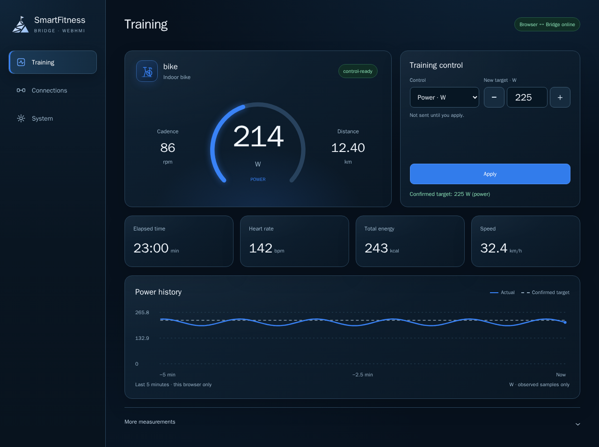 | 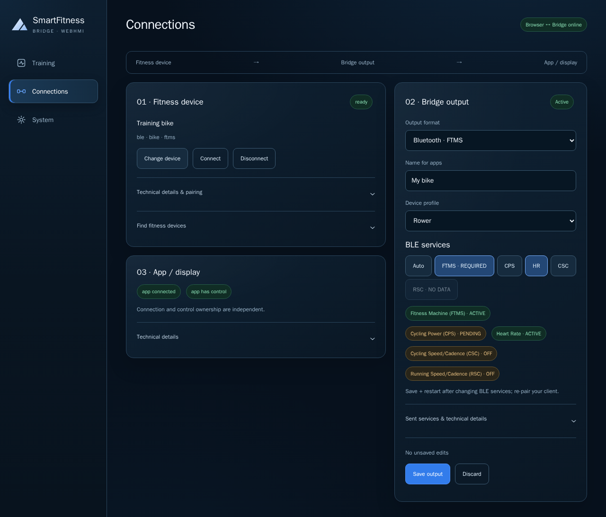 |
| 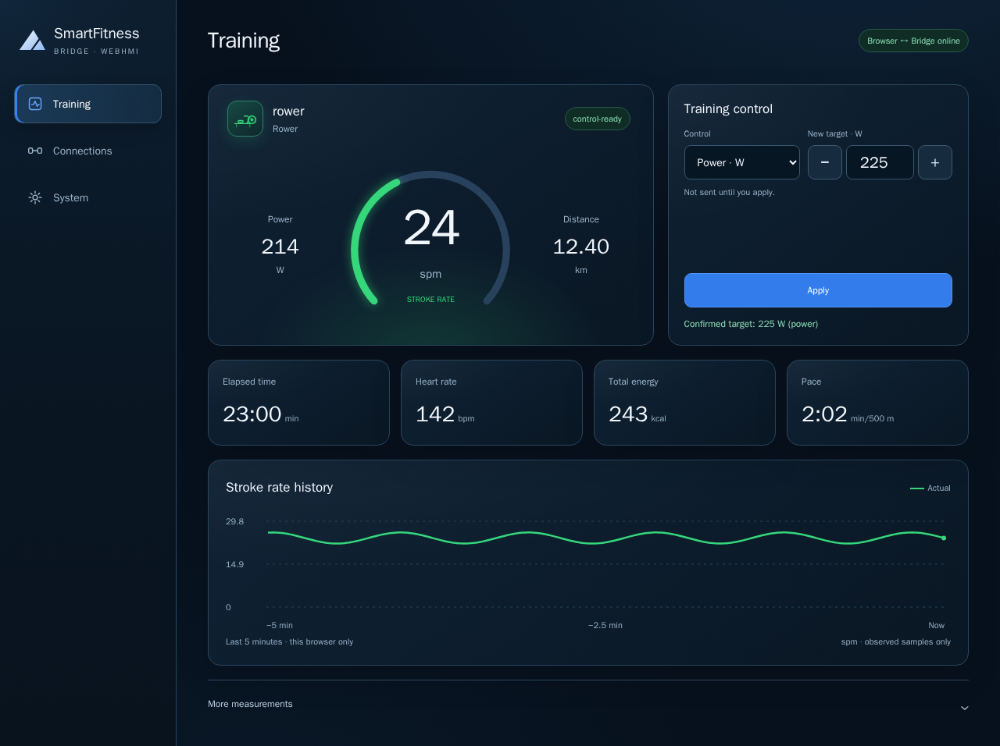 | 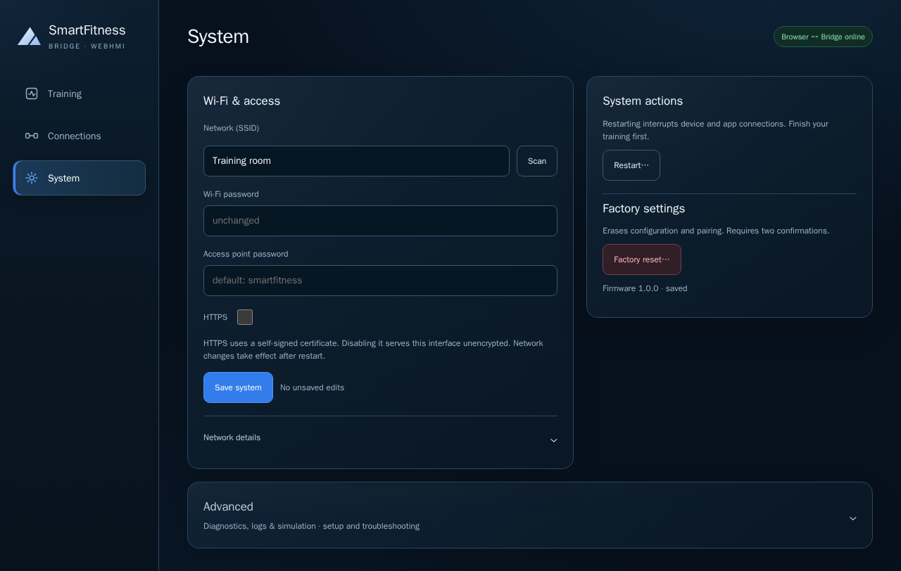 |

Mobile (390×844; full-page screenshots include scrollable content):

| Training | Connections |
|---|---|
| 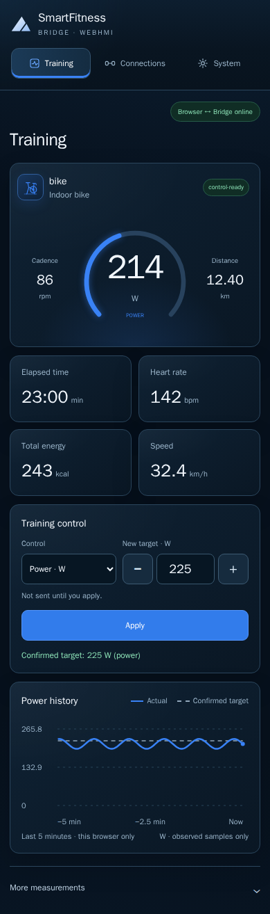 | 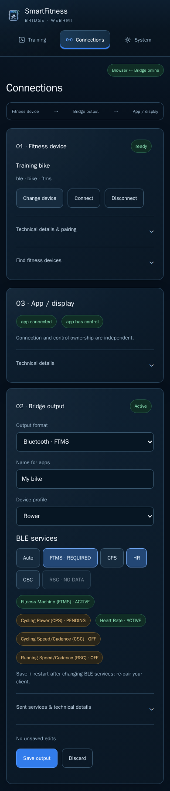 |
| 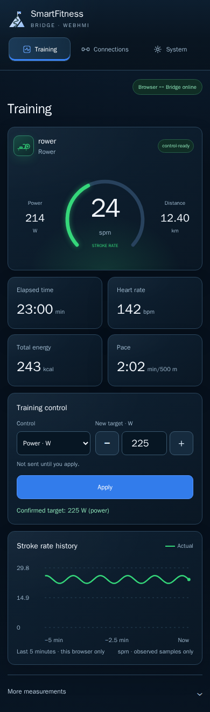 | 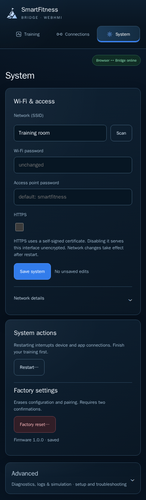 |

All remaining profiles:

| Profile | Desktop | Mobile |
|---|---|---|
| Treadmill | 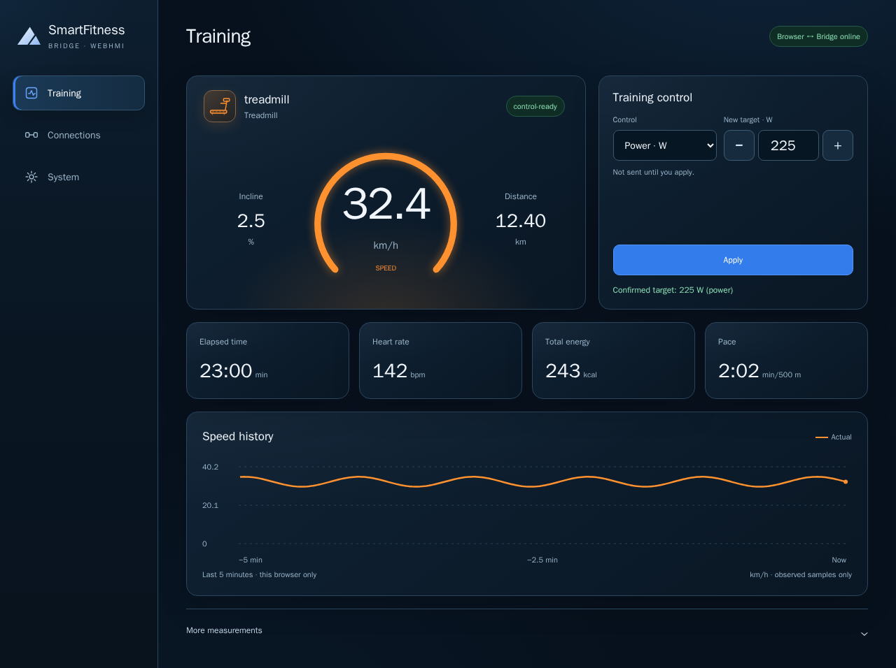 | 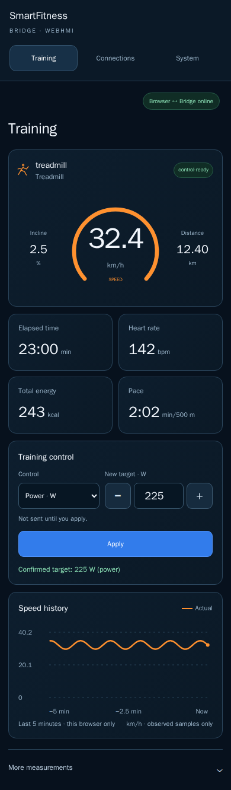 |
| Cross trainer |  |  |
| Step climber |  |  |
| Stair climber |  |  |

Optional `DEBUG_WEB` build:

| Debug desktop | Debug mobile |
|---|---|
|  |  |

## Before / after

The older elbow/sidebar screens are historical references and are not regenerated.
Current screenshots show the navy training design. The CrowPanel display,
rotary encoder and knob were tested with the preceding firmware; the new gallery
remains simulator renders. Firmware flash/static RAM and runtime headroom should
be checked with the target build and hardware.
The scrollbar adds one LVGL arc per list/roller, with no timer or heap-allocated
callback context; runtime RAM must still be measured on hardware.

| Screen | Previous elbow/sidebar | Current navy design |
|---|---|---|
| Device detail |  |  |
| Devices list |  |  |

The baseline images were rendered from the pre-restyle interface with the same
sample data. They are historical references, not regenerated by the update script.

| HMI before | HMI after |
|---|---|
|  |  |

| Web before | Web after |
|---|---|
|  |  |

## Regeneration

Run from the repository root on Linux. Download/extract the LVGL **v9.2.2**
release into `.cache/lvgl` (with `lvgl.h` directly inside that directory).
The committed generated fonts mean Node/font tools are not needed for screenshots
or firmware builds.

```sh
python3 -m pip install -r scripts/requirements-screenshots.txt
python3 -m playwright install --with-deps chromium
bash scripts/update_hmi_docs.sh
# Optional: one interface only, or check without overwriting committed images
LVGL_DIR=/path/to/lvgl-9.2.2 bash scripts/update_hmi_docs.sh --hmi
bash scripts/update_hmi_docs.sh --check
```

The script renders the actual LVGL sources and runs the knob-only walkthrough
plus theme/font, curved-scrollbar visibility/position/resize/lifecycle/roller
and round-safe focus-target assertions. Service screens additionally exercise
live subscription/availability/mask/restart redraws, retained knob focus, and
English/German layouts at every focus position. A geometric layout check on every
screenshot (and on every dashboard metric of every machine profile at its
widest value) fails if the focus ring is clipped, if drawn elements or text
ink overlap each other or the circular arcs, if a roller row is cut, or if
anything leaves the round panel. The web script routes
the actual HTML and deterministic API/WebSocket fixtures inside the browser
(no external server or hardware) and uses the pinned Chromium version.
It checks keyboard navigation, mobile overflow, result alerts and absence of
external requests. To use the original entry point:

```sh
make hmi-screenshots LVGL_DIR=.cache/lvgl SIM_BUILD=.cache/hmi-sim SCREENSHOT_DIR=.cache/hmi-screenshots
python3 scripts/web_screenshots.py --output .cache/web-screenshots
```

CI retains `host-tests`, both firmware builds and `hmi-simulator`, and adds
`web-screenshots`. HMI pixel differences **fail** the committed-gallery check.
Web differences **warn** because browser/OS rasterization can differ. Both jobs
upload PNG artifacts for review. For separate artifact copies set
`SCREENSHOT_DIR=.cache/ui-artifacts` when running the update script.

To regenerate fonts using the committed, licensed source:

```sh
python3 -m pip install -r scripts/requirements-fonts.txt
# Node/npm needed only here; the script pins lv_font_conv 1.5.3.
bash scripts/generate_ui_fonts.sh
python3 scripts/embed_web_assets.py
bash scripts/update_hmi_docs.sh
```

The font script creates a static weight-400 instance using FontTools, subsets
WOFF2 using Brotli and generates LVGL C arrays using `lv_font_conv`.
It no longer modifies the web asset, which uses system fonts.

See [HD-008](../hardware-decisions.md#hd-008-shared-lcars-inspired-interface-design)
for memory impact and the decision boundary.
