# LCARS-inspired user interfaces

One original, LCARS-inspired design system serves the **CrowPanel 1.28" round
240×240 HMI** (`crowpanel128`, LVGL 9.2.2) and the **self-contained web app**
(`esp32s3dev`). The visual reference is the warm, flat, condensed design language
of TNG-era interfaces; these are not reproductions of screen assets.

**Not hardware-verified.** These are actual LVGL and Chromium renders with fixed
sample data, not photographs. Colours, small text, touch accuracy, IPS contrast,
frame rate, heap/PSRAM headroom and readability require checks on the real panel.
Commands, safety confirmations, API contracts, BLE and FTMS behavior are unchanged.

## Shared design system

The tokens below are the design specification. HMI implementation:
[`lcars_theme.h`](../../include/variants/hmi/lcars_theme.h) and
[`lcars_theme.cpp`](../../src/variants/hmi/lcars_theme.cpp).
Web implementation: CSS custom properties in
[`src/variants/web/assets/index.html`](../../src/variants/web/assets/index.html).
There are no gradients, shadows, textured materials or external web resources.

| Token | Colour | Role |
|---|---|---|
| Black | `#000000` | Background and negative space; text on coloured pills |
| Orange | `#FF9900` | Primary frame and navigation |
| Golden | `#FFAA00` | Active/pressed controls |
| Peach | `#FFCC99` | Navigation and highlighted selection |
| Tan | `#CC9966` | Secondary frame segments, inactive gauge |
| Lavender | `#CC99CC` | Secondary actions and targets |
| Violet | `#9999FF` | Sensor/list data |
| Light blue | `#99CCFF` | Telemetry and readouts |
| Blue | `#5566FF` | Data accents |
| Alert | `#CC4444` | Failure, disconnect, stale data, stop and destructive actions |
| White | `#FFFFFF` | Keyboard/knob focus border; web `:focus-visible` outline |

### Typography and licence

**Antonio Regular (weight 400)** is a tall condensed sans-serif by Vernon Adams,
licensed under the **SIL Open Font License 1.1**. The original variable font and
[`OFL.txt`](../../assets/fonts/OFL.txt) are committed in `assets/fonts/`.
Source: [Google Fonts Antonio](https://github.com/google/fonts/tree/main/ofl/antonio).
Both variants subset `U+0020–007E` and `U+00A0–00FF`, including digits and German
umlauts. HMI text sizes are **16 and 20 px**; the **48 px** readout subsets digits
and numeric punctuation only. Fonts use 4-bit antialiasing, uncompressed LVGL
bitmaps. LVGL's Montserrat 14 is retained only as a symbol fallback.
Web uses a **9,292-byte WOFF2**, embedded as a data URL in the HTML and gzipped
with the page into flash; it never makes a font request. The whole compressed
page grows **5,334 → 17,522 bytes (+12,188 B)**; the font payload contributes
**10,299 B** of that compressed asset.

UI labels are displayed uppercase; editable names and underlying device/adapter
identifiers retain their values. Numeric codes such as `02-338` are decoration,
not commands or IDs. Text on bright fills is black; body data is light blue or
peach on black. Error indicators also include text, not colour alone.

### Shapes and states

- HMI: header-only arc follows the top circular edge, with rounded pill
  endcaps, uppercase title, numeric code and a thin peach separator. There is
  no elbow, vertical sidebar or bottom frame.
- Web: intentionally retains the swept elbow, title bar and desktop sidebar
  (responsive navigation pills on phones). This HMI revision does not change it.
- Navigation/action pills: solid fills, rounded endcaps, right-aligned labels.
  Ordinary HMI action targets are at least 36 px tall; touch adjustment helpers
  are 44×44 px. The existing compact text keyboard is also operable by knob;
  use the larger preset pills when possible.
- Data: large central digits, small unit, labelled secondary/status readouts;
  blue segments fill an arc (HMI) or a linear gauge (web).
- Focus: brighter selection with a white outline, including `:focus-visible`.
  On the HMI the knob cursor is a 2 px white inner border plus a 2 px orange
  ring 1 px outside the focused pill/roller/keyboard (light blue while
  editing). Lists, button rows and the roller keep 3 px of padding
  (`lcars::FocusRing`) so the ring is never clipped. Keyboard keys use the
  inner border only. The dashboard, whose whole circle is the only knob
  target, draws no ring on the panel edge.
  Pressed: golden colour swap. Disabled: dimmed and non-actionable.
- HMI red alert colours only the header arc for disconnected/stale status,
  command rejection, speed confirmation and factory reset. The scrollbar and
  telemetry gauge retain their normal colours. Stop/destructive action pills
  keep their existing semantic red. No blinking is required.
- HMI status snapshots remain at **200 ms (≤5 Hz)**; scan refresh remains 1 Hz.
  Web respects `prefers-reduced-motion`.

### Round-display adaptation

The dashboard and adjustment gauges follow the circular edge with 24 separated
arc segments. The frame is confined to the header on every HMI screen.
Lists gain 18 px of width and are centred inside the circle; corners are not
used for essential labels/actions. Long device names also wrap in the detail body;
the header title is a single line between the header arc and the separator
(long titles end in an ellipsis). Dashboard readouts are stacked without
touching lines (the unit sits on the value's baseline), the adapter roller
shows three complete rows, and the adjustment +/- helpers stay inside the
gauge ring.
Scrollable lists and the adapter/model roller have a **left curved scrollbar**:
a dim lavender 4 px track and orange 6 px thumb follow the left circular edge.
Thumb length represents the visible fraction (minimum 8° for very long content);
position represents the clamped scroll offset. It updates with swipe scrolling,
encoder focus/roller movement and content/layout changes. LVGL's straight
scrollbar is disabled. Non-scrollable content hides the arc completely:
dashboard and short confirmation dialogs leave the left side without a scrollbar.
Lists settle their layout before scrolling to focused pills and preserve
the existing encoder focus order. The outside of each simulator PNG is masked
grey to show the physical round boundary. The rectangular web frame uses a
sidebar on desktop and a navigation pill row on narrow phones.

### Legal boundary

**“LCARS-inspired” only:** original shapes and colours plus the freely licensed
font. No Star Trek/Starfleet logos, insignia, registry imagery, copied screen
assets, sounds or branded product identity are included. No affiliation or
endorsement is implied.

## Navigation

- **HMI knob:** dashboard turn cycles metrics; press opens the navigation menu.
  Turn moves focus; press selects. In adjustment, turn changes the value and
  press applies. Hold goes back/cancels. Speed changes retain confirmation;
  factory reset retains two confirmations, each initially focused on Cancel.
- **HMI touch:** tap pills/readout, swipe right to go back; swipe left/right
  on the dashboard cycles metrics. +/- adjust values; Apply uses the same
  confirmation path. Names retain presets and the on-screen keyboard.
- **Web:** Dashboard, Devices, Control, Settings tabs work on desktop/phone.
  Use Tab/Shift-Tab to move focus and Enter/Space to activate controls; tab
  navigation also supports arrow keys and Home/End. Fields retain labels,
  status/result announcements and the original asynchronous result flow.
  Stop and destructive actions remain visibly distinct.

## HMI gallery

| Dashboard: bike | Dashboard: treadmill | Knob navigation |
|---|---|---|
|  | 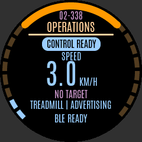 | 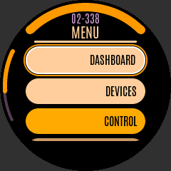 |

| Devices / scan | Focused scan results | Device details |
|---|---|---|
| 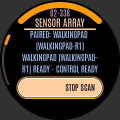 | 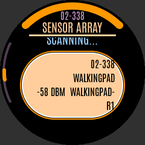 | 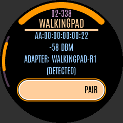 |

| Adapter/model selection | Treadmill controls | Speed adjustment |
|---|---|---|
| 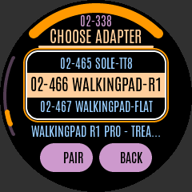 | 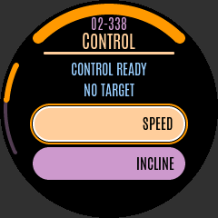 | 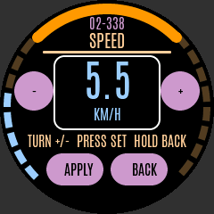 |

| Red-alert speed confirmation | Bike controls | Power adjustment |
|---|---|---|
|  | 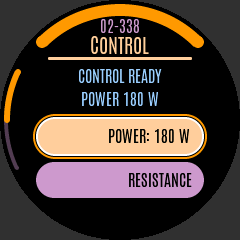 | 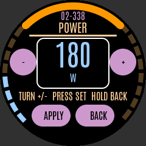 |

| Settings | Scrolled settings / knob focus | Name presets |
|---|---|---|
| 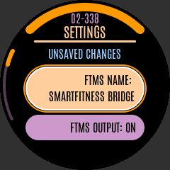 | 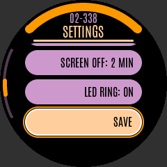 | 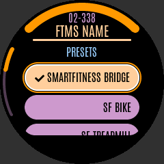 |

| Keyboard | Reset: first confirmation | Reset: second confirmation |
|---|---|---|
| 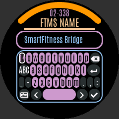 | 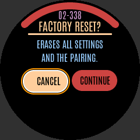 | 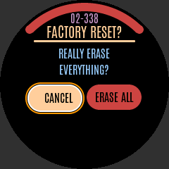 |

| Rejected command | Disconnected/stale |
|---|---|
| 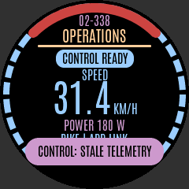 | 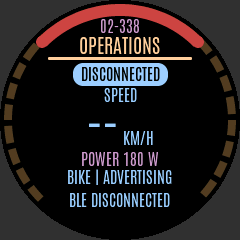 |

| Long devices list: top | Middle | Bottom |
|---|---|---|
| 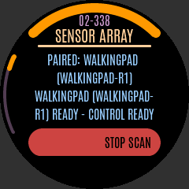 | 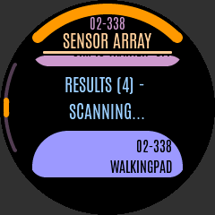 | 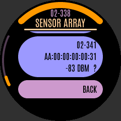 |

## Web gallery

Desktop (1280×800):

| Dashboard | Devices |
|---|---|
|  | 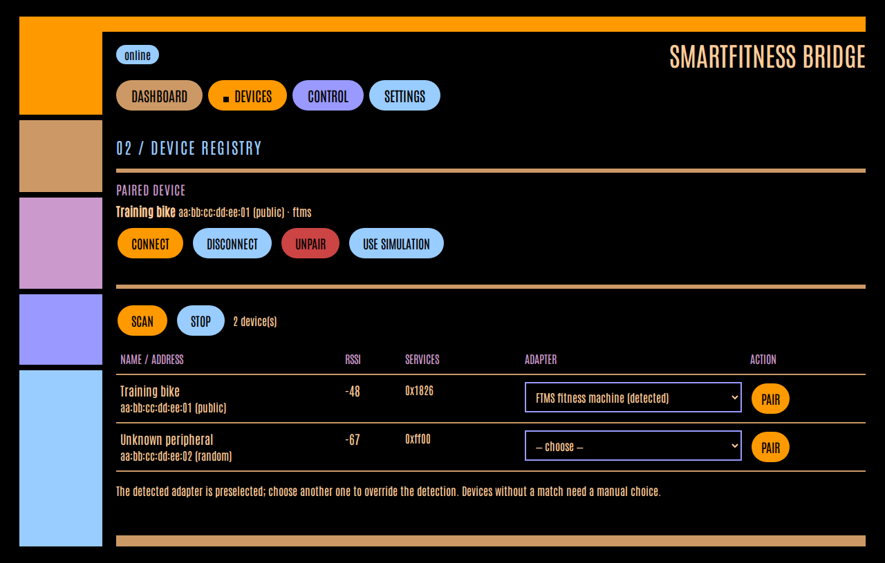 |
| 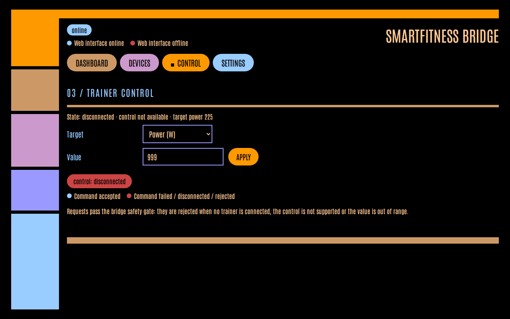 | 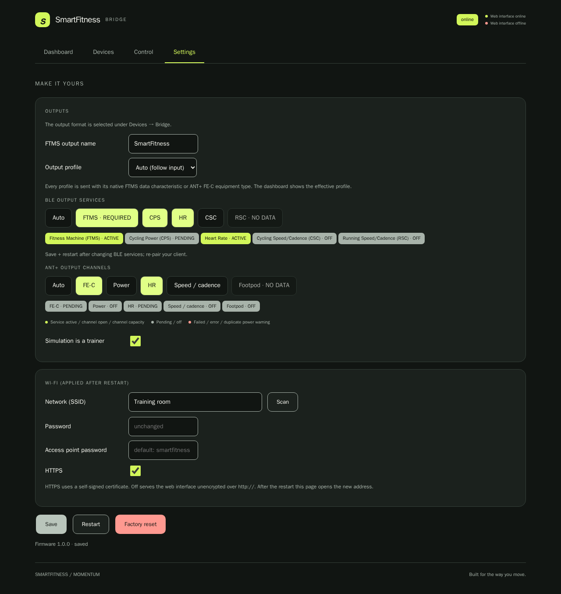 |

Mobile (390×844; full-page screenshots include scrollable content):

| Dashboard | Devices |
|---|---|
| 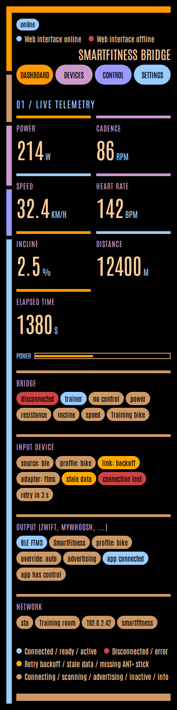 | 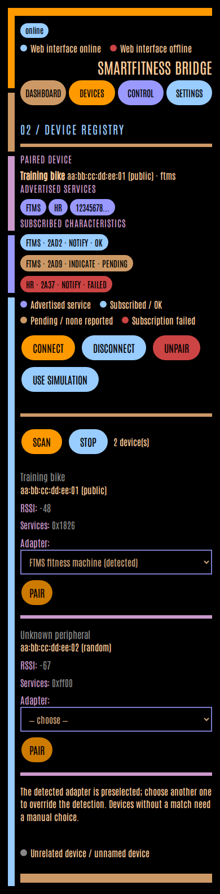 |
| 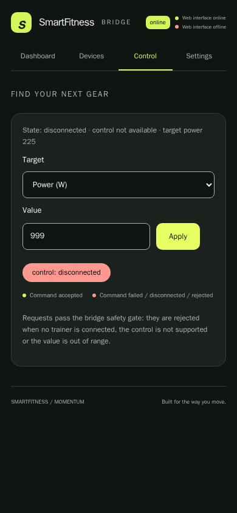 | 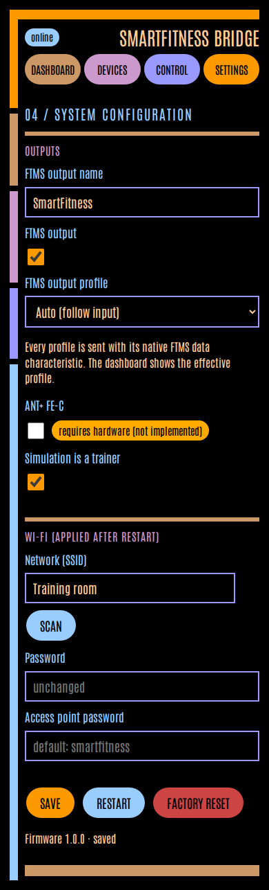 |

## Before / after

Header-only HMI revision (same fixtures; historical elbow images are not
regenerated). The web UI and its screenshots are unchanged. Nothing is
hardware-verified; firmware flash/static RAM delta is unavailable locally
because PlatformIO's `espressif32` download fails before compilation.
The scrollbar adds one LVGL arc per list/roller, with no timer or heap-allocated
callback context; runtime RAM must still be measured on hardware.

| Screen | Previous elbow/sidebar | Header-only + curved scrollbar |
|---|---|---|
| Device detail | 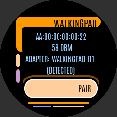 |  |
| Devices list | 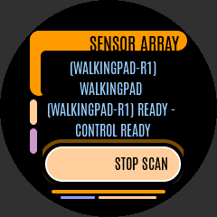 |  |

The baseline images were rendered from the pre-restyle interface with the same
sample data. They are historical references, not regenerated by the update script.

| HMI before | HMI after |
|---|---|
| 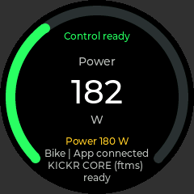 |  |

| Web before | Web after |
|---|---|
| 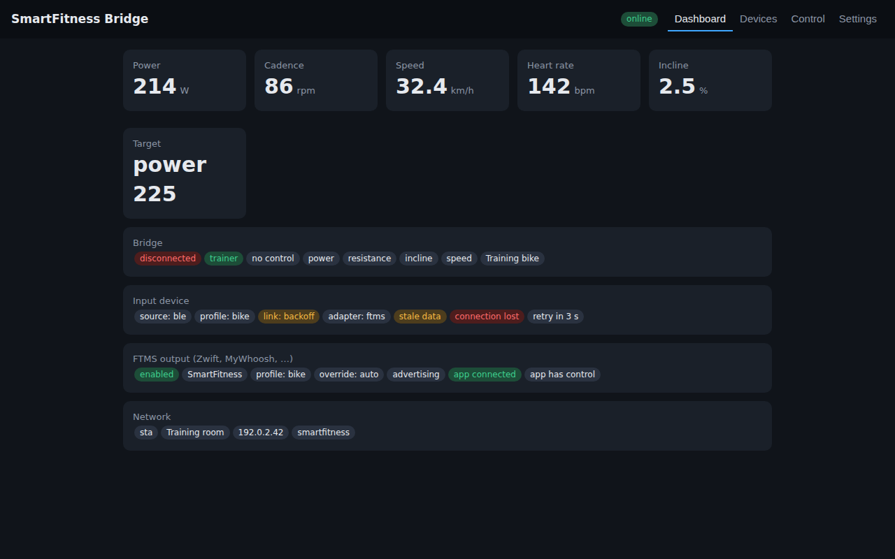 |  |

## Regeneration

Run from the repository root on Linux. Download/extract the LVGL **v9.2.2**
release into `.cache/lvgl` (with `lvgl.h` directly inside that directory).
The committed generated fonts mean Node/font tools are not needed for screenshots
or firmware builds.

```sh
python3 -m pip install -r scripts/requirements-screenshots.txt
python3 -m playwright install --with-deps chromium
bash scripts/update_hmi_docs.sh
# Optional: one interface only, or check without overwriting committed images
LVGL_DIR=/path/to/lvgl-9.2.2 bash scripts/update_hmi_docs.sh --hmi
bash scripts/update_hmi_docs.sh --check
```

The script renders the actual LVGL sources and runs the knob-only walkthrough
plus theme/font, curved-scrollbar visibility/position/resize/lifecycle/roller
and round-safe focus-target assertions. A geometric layout check on every
screenshot (and on every dashboard metric of every machine profile at its
widest value) fails if the focus ring is clipped, if drawn elements or text
ink overlap each other or the LCARS arcs, if a roller row is cut, or if
anything leaves the round panel. The web script routes
the actual HTML and deterministic API/WebSocket fixtures inside the browser
(no external server or hardware) and uses the pinned Chromium version.
It checks keyboard navigation, mobile overflow, result alerts and absence of
external requests. To use the original entry point:

```sh
make hmi-screenshots LVGL_DIR=.cache/lvgl SCREENSHOT_DIR=/tmp/hmi-screenshots
python3 scripts/web_screenshots.py --output /tmp/web-screenshots
```

CI retains `host-tests`, both firmware builds and `hmi-simulator`, and adds
`web-screenshots`. HMI pixel differences **fail** the committed-gallery check.
Web differences **warn** because browser/OS rasterization can differ. Both jobs
upload PNG artifacts for review. For separate artifact copies set
`SCREENSHOT_DIR=/tmp/ui-artifacts` when running the update script.

To regenerate fonts using the committed, licensed source:

```sh
python3 -m pip install -r scripts/requirements-fonts.txt
# Node/npm needed only here; the script pins lv_font_conv 1.5.3.
bash scripts/generate_ui_fonts.sh
python3 scripts/embed_web_assets.py
bash scripts/update_hmi_docs.sh
```

The font script creates a static weight-400 instance using FontTools, subsets
WOFF2 using Brotli, generates LVGL C arrays using `lv_font_conv`, and refreshes
the single embedded web-font payload.

See [HD-008](../hardware-decisions.md#hd-008-shared-lcars-inspired-interface-design)
for memory impact and the decision boundary.
