# Momentum / A little less interface. A lot more movement.

One reduced, sport-inspired design system serves the **CrowPanel 1.28" round
240×240 HMI** (`crowpanel128`, LVGL 9.2.2) and the **self-contained web app**
(`esp32s3dev`). Charcoal surfaces, warm-white readouts and one electric-lime
accent bring the focus back to effort. The tone is encouraging, not competitive:
no invented scores, goals, workout history or claims about a rider's performance.

The HMI display, rotary encoder (turning/direction), and knob press have been tested
and work on the real CrowPanel. Gallery images are simulator renders with fixed
sample data, not photographs; the web UI remains unverified on hardware. Touch
accuracy, colours, small text, IPS contrast, frame rate, heap/PSRAM headroom and
readability still require checks on the real panel. Commands, safety confirmations,
API contracts, BLE and FTMS behavior are unchanged.

## Shared design system

| Web / desktop | Web / phone |
|---|---|
| 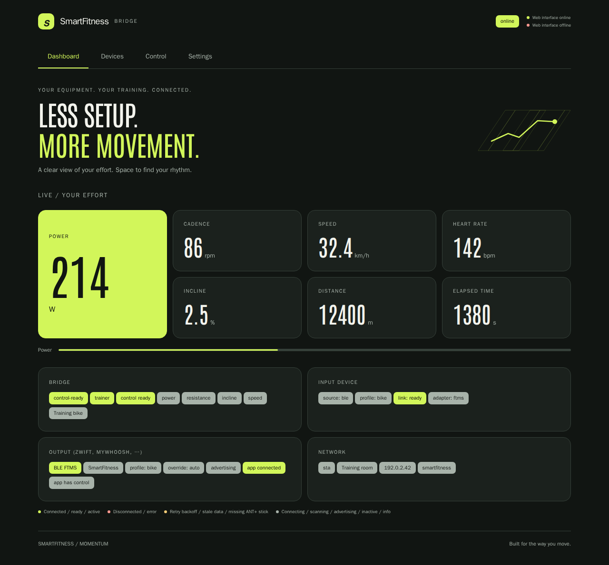 | 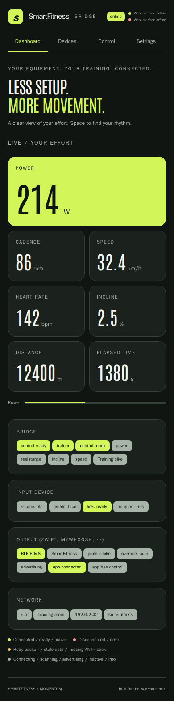 |

The tokens below are the design specification. HMI implementation (legacy
`lcars` identifiers are retained to avoid changing screen/control contracts):
[`lcars_theme.h`](../../include/variants/hmi/lcars_theme.h) and
[`lcars_theme.cpp`](../../src/variants/hmi/lcars_theme.cpp).
Web implementation: CSS custom properties in
[`src/variants/web/assets/index.html`](../../src/variants/web/assets/index.html).
There are no gradients, shadows, textured materials or external web resources.

| Token | Colour | Role |
|---|---|---|
| Charcoal | `#111512` | Background / negative space |
| Surface | `#1B211D` | Web cards and secondary actions |
| Line | `#354039` | Web borders and meter track |
| Warm white | `#F3F4ED` | Readouts and primary text |
| Sage | `#A8B3AA` | Secondary text and neutral status fills |
| Mist | `#BAC8BD` | HMI secondary actions and service fills |
| Electric lime | `#D2F65A` | Primary action, selected tab, power tile, active gauge, ready status |
| Soft lime | `#E1FF87` | Pressed/selected controls |
| Coral | `#FF9990` | Errors, stop, disconnect and destructive actions |
| Amber | `#F4CC77` | Web warnings, stale data and retry backoff |
| White | `#FFFFFF` | HMI keyboard/knob focus border |

Use one dominant accent per view; neutral surfaces do the grouping. Web spacing
uses a 4 px base, 12 px grid gaps, 16 px card radii and 44 px minimum controls.
Power is highlighted only when a finite power measurement is actually present.
Other machine profiles retain their native metrics; missing data is never
replaced with a fictitious workout. The original inline route illustration is
decorative, hidden from assistive technology and omitted on phones.

### Typography and licence

**Antonio Regular (weight 400)** is a tall condensed sans-serif by Vernon Adams,
licensed under the **SIL Open Font License 1.1**. The original variable font and
[`OFL.txt`](../../assets/fonts/OFL.txt) are committed in `assets/fonts/`.
Source: [Google Fonts Antonio](https://github.com/google/fonts/tree/main/ofl/antonio).
Both variants subset `U+0020–007E` and `U+00A0–00FF`, including digits and German
umlauts. HMI text sizes are **16 and 20 px**; the **48 px** readout subsets digits
and numeric punctuation only. Fonts use 4-bit antialiasing, uncompressed LVGL
bitmaps. LVGL's Montserrat 14 is retained only as a symbol fallback.
Web uses system sans-serif for body text and controls (14 px), with Antonio
reserved for the expressive headline and tabular numeric readouts (48 px,
100 px for primary desktop power). The existing **9,292-byte WOFF2** is embedded
as a data URL and gzipped with the page into flash; it never makes a font request.
The screenshot script prints the current compressed asset size.

HMI labels and web section/metric labels are uppercase; web actions and body text
use sentence case. Editable names and underlying device/adapter identifiers
retain their values. Text on bright fills is dark; readouts are warm white on
charcoal. Error indicators also include text, not colour alone.

### Shapes and states

- HMI: the header is a filled lime pill band behind the uppercase title,
  which is drawn inverse (black), like the dashboard state pill. There is no
  top arc, elbow, vertical sidebar or bottom frame, so the gauge ring runs
  uninterrupted across the top.
- Web: no decorative rails, elbows or multicolour navigation. A quiet tab bar
  uses a lime underline for selection. Four metric columns become two on phones;
  the primary power tile spans two rows on desktop and two columns on phones.
  Supporting bridge, input, output and network details remain available below.
- Actions: solid fills, 10 px corners, left-aligned HMI labels.
  Ordinary HMI action targets are at least 36 px tall; touch adjustment helpers
  are 44×44 px. The existing compact text keyboard is also operable by knob;
  use the larger preset pills when possible.
- Data: large central digits, small unit, labelled secondary/status readouts;
  lime segments fill a thin 5 px arc (HMI) or a linear gauge (web).
- Signal strength (HMI): a 4-bar pictogram (`lcars::signalBars`) replaces the
  numeric RSSI in scan results (black on the pill, left of the label) and device
  details (warm white). Bars lit: ≥ −60 dBm 4, ≥ −70 dBm 3, ≥ −80 dBm 2, else 1;
  unlit bars stay visible at 30 % opacity so the level reads by shape.
- Focus: web `:focus-visible` uses a 2 px lime outline with a 4 px offset.
  On the HMI the knob cursor is a 2 px white inner border plus a 2 px lime
  ring 1 px outside the focused pill/roller/keyboard (warm white while
  editing). Lists, button rows and the roller keep 3 px of padding
  (`lcars::FocusRing`) so the ring is never clipped. Keyboard keys use the
  inner border only. The dashboard, whose whole circle is the only knob
  target, draws no ring on the panel edge.
  Pressed: soft-lime colour swap. Disabled: dimmed and non-actionable.
- HMI coral alert colours only the header band for disconnected/stale status,
  command rejection, speed confirmation and factory reset. The scrollbar and
  telemetry gauge retain their normal colours. Stop/destructive action pills
  keep their semantic coral. No blinking is required.
- HMI status snapshots remain at **200 ms (≤5 Hz)**; scan refresh remains 1 Hz.
  Web respects `prefers-reduced-motion`.

### Round-display adaptation

The dashboard and adjustment gauges follow the circular edge with 24 separated
arc segments, fully visible along the top. The frame is confined to the
header band on every HMI screen.
Lists gain 18 px of width and are centred inside the circle; corners are not
used for essential labels/actions. Long device names also wrap in the detail body;
the header title is a single line inside the header band (long titles end in
an ellipsis). Dashboard readouts are stacked without
touching lines (the unit sits on the value's baseline), the adapter roller
shows three complete rows, and the adjustment +/- helpers stay inside the
gauge ring.
Scrollable lists and the adapter/model roller have a **left curved scrollbar**:
a dim sage 4 px track and lime 6 px thumb follow the left circular edge.
Thumb length represents the visible fraction (minimum 8° for very long content);
position represents the clamped scroll offset. It updates with swipe scrolling,
encoder focus/roller movement and content/layout changes. LVGL's straight
scrollbar is disabled. Non-scrollable content hides the arc completely:
dashboard and short confirmation dialogs leave the left side without a scrollbar.
Lists settle their layout before scrolling to focused pills and preserve
the existing encoder focus order. The outside of each simulator PNG is masked
grey to show the physical round boundary. Web tabs remain in a single row on
desktop and narrow phones.

### Assets

The route artwork and brand mark are original inline shapes/text. The existing
Antonio font retains its SIL Open Font License. No external images, trackers,
font requests or new runtime dependencies are introduced.

## Navigation

- **HMI knob:** dashboard turn cycles metrics; press opens the navigation menu.
  Turn moves focus; press selects. In adjustment, turn changes the value and
  press applies. Hold goes back/cancels. Speed changes retain confirmation;
  factory reset retains two confirmations, each initially focused on Cancel.
- **HMI touch:** tap pills/readout, swipe right to go back; swipe left/right
  on the dashboard cycles metrics. +/- adjust values; Apply uses the same
  confirmation path. Names retain presets and the on-screen keyboard.
- **Web:** Dashboard, Devices, Control, Settings tabs work on desktop/phone.
  Use Tab/Shift-Tab to move focus and Enter/Space to activate controls; tab
  navigation also supports arrow keys and Home/End. Fields retain labels,
  status/result announcements and the original asynchronous result flow.
  Stop and destructive actions remain visibly distinct.

## HMI gallery

| Dashboard: bike | Dashboard: treadmill | Knob navigation |
|---|---|---|
|  |  |  |

| Devices / scan | Focused scan results | Device details |
|---|---|---|
|  |  |  |

| Adapter/model selection | Treadmill controls | Speed adjustment |
|---|---|---|
|  |  |  |

| Red-alert speed confirmation | Bike controls | Power adjustment |
|---|---|---|
|  |  |  |

| Settings | Scrolled settings / knob focus | Name presets |
|---|---|---|
|  |  |  |

| Keyboard | Reset: first confirmation | Reset: second confirmation |
|---|---|---|
|  |  |  |

| Rejected command | Disconnected/stale |
|---|---|
|  |  |

| Long devices list: top | Middle | Bottom |
|---|---|---|
|  |  |  |

| Input: advertised services | Subscribed notification | Failed subscription |
|---|---|---|
| 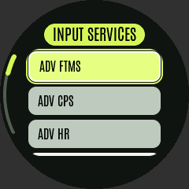 | 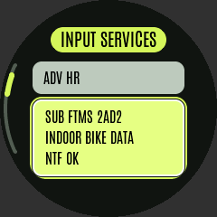 | 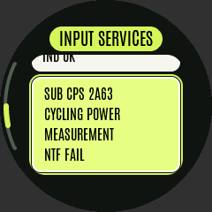 |

| Pending subscription | Output services | Optional service without data |
|---|---|---|
| 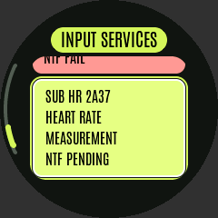 | 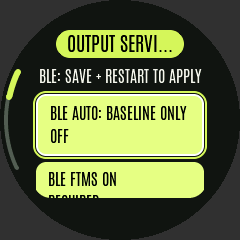 | 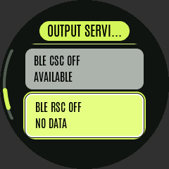 |

| BLE service change pending restart |
|---|
| 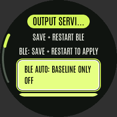 |

| ANT+ UART module detected | ANT+ channels | No ANT+ module |
|---|---|---|
| 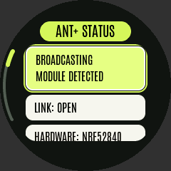 | 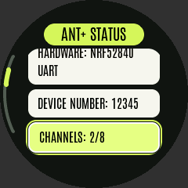 | 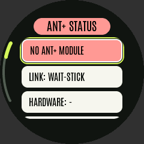 |

| ANT+ channel selection | Duplicate-power warning |
|---|---|
| 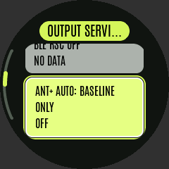 | 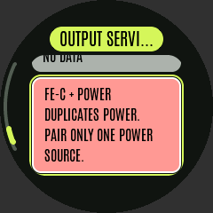 |

### Service diagnostics and settings

**Devices → Input services** shows the paired device's advertised UUIDs (`ADV`,
violet) and subscription attempts (`SUB`). Each subscription names its service,
characteristic and mode (`NTF` notification / `IND` indication), with textual
`OK` (warm white), `FAIL` (coral) or `PENDING` (sage) state. These are diagnostics,
not controls. Every row is a focusable, wrapping pill so the knob can scroll
through all entries without touch. Scan-device details also show advertised
services. Unknown UUIDs retain a shortened identifier.

**Settings → Output services** offers Auto and BLE FTMS/CPS/HR/CSC/RSC pills.
FTMS is mandatory; the other four are independent selections. Each pill
distinguishes on/off from active, available or no-data state. The shared
controller validates each request; a rejected selection shows its reason in
the command-result toast. Selected services are golden, off services tan, and
enabled services without available data alert red; activity is a separate
readout, not the selection colour. Unavailable off services remain readable by
knob but cannot be enabled. Auto is mask `0`, meaning **baseline FTMS only**, not all
services; explicit bits are FTMS `1`, CPS `2`, HR `4`, CSC `8`, RSC `16`.
Changes use the shared `SetOutputServices` command with transport `ftms`.
Save persists the selection. BLE service changes use a boot-only GATT topology;
an explicit save-and-restart hint is always visible and the live
`restartRequired` flag adds a definite warning.
**Settings → Output** cycles **BLE FTMS → ANT+ → Off** when the live status
reports an available ANT transport, including when its module is not detected.
Without a transport, it keeps the **BLE FTMS → Off** cycle.
With a transport, **Output services** also offers ANT+ Auto and independent
FE-C/Power/HR/Speed-cadence/Footpod toggles. Auto is mask `0` (FE-C baseline);
explicit bits are `1/2/4/8/16`. Unlike BLE FTMS, FE-C can be disabled when another
channel remains selected. Disabling the last channel is rejected with a hint
to choose Auto explicitly. Source-unavailable off channels cannot be enabled.
Each control shows broadcasting, available or no-data state, and selecting both
FE-C and Power shows an alert warning to pair only one power source in the app.
Changes use `SetOutputServices` with transport `ant`; Save persists them.
**Settings → ANT+ status** (also reachable from Output services) shows the live
link, detected hardware, device number, open/channel-limit counts, individual
channel enablement/broadcast/data state, and display/control activity. These
warm-white, read-only pills are fully scrollable by knob. Module detection is
explicit even when output is off. No module, a waiting selected output or a
reported error uses a coral alert header and alert status pill;
it does not claim that a display is connected merely because a channel is open.
Labels have English and German translations. The gallery uses simulated UART
module data; it is not evidence of a physical radio connection.
Dashboard and Devices show compact `OUT`
summaries of enabled services; enablement alone does not imply live data.
New service strings include English and German translations.
See [HD-009](../hardware-decisions.md#hd-009-selectable-ble-services-and-ant-output-channels)
for schema migration, boot-frozen GATT and ANT radio/channel decisions.

## Web gallery

Desktop (1280×800):

| Dashboard | Devices |
|---|---|
|  |  |
|  |  |

Mobile (390×844; full-page screenshots include scrollable content):

| Dashboard | Devices |
|---|---|
|  |  |
|  |  |

Optional `DEBUG_WEB` build:

| Debug desktop | Debug mobile |
|---|---|
| 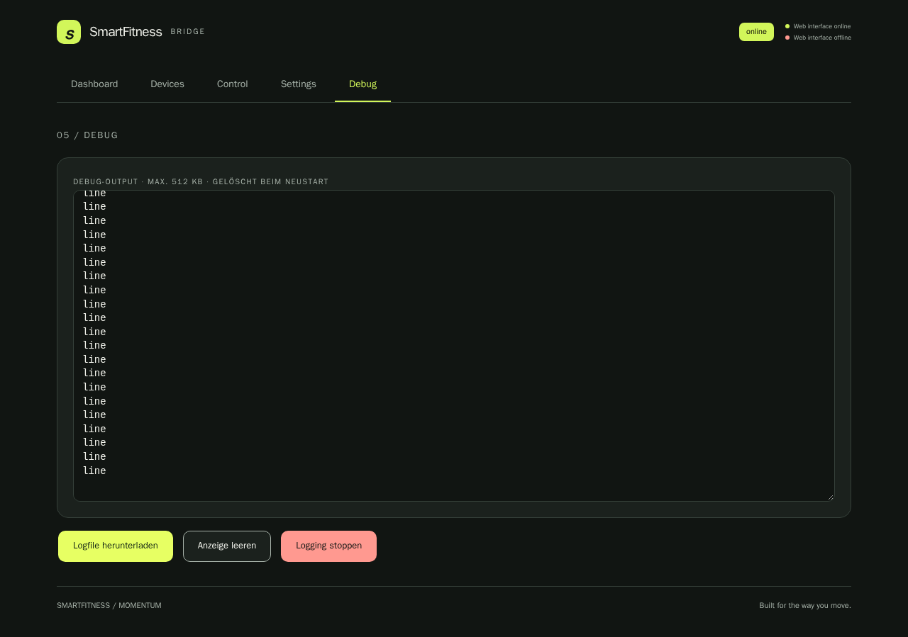 | 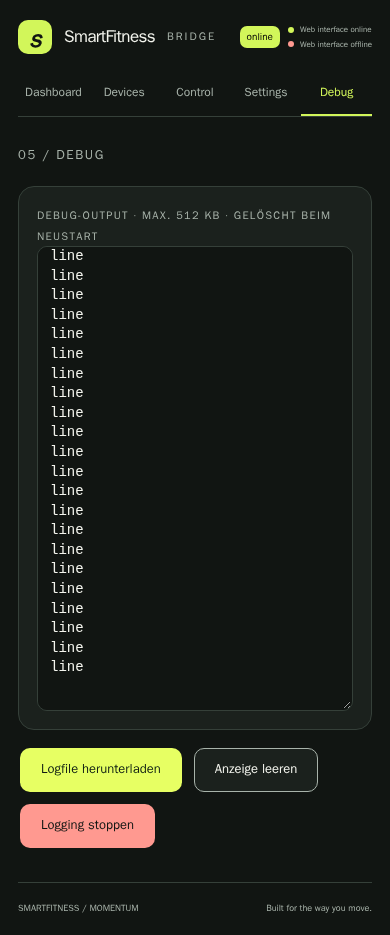 |

## Before / after

Header-only HMI revision (same fixtures; historical elbow images are not
regenerated). The web UI and its screenshots are unchanged. The CrowPanel display,
rotary encoder and knob have been tested on hardware; the gallery images remain
simulator renders, and the web UI is unverified on hardware. Firmware flash/static
RAM delta is unavailable locally
because PlatformIO's `espressif32` download fails before compilation.
The scrollbar adds one LVGL arc per list/roller, with no timer or heap-allocated
callback context; runtime RAM must still be measured on hardware.

| Screen | Previous elbow/sidebar | Header-only + curved scrollbar |
|---|---|---|
| Device detail |  |  |
| Devices list |  |  |

The baseline images were rendered from the pre-restyle interface with the same
sample data. They are historical references, not regenerated by the update script.

| HMI before | HMI after |
|---|---|
|  |  |

| Web before | Web after |
|---|---|
|  |  |

## Regeneration

Run from the repository root on Linux. Download/extract the LVGL **v9.2.2**
release into `.cache/lvgl` (with `lvgl.h` directly inside that directory).
The committed generated fonts mean Node/font tools are not needed for screenshots
or firmware builds.

```sh
python3 -m pip install -r scripts/requirements-screenshots.txt
python3 -m playwright install --with-deps chromium
bash scripts/update_hmi_docs.sh
# Optional: one interface only, or check without overwriting committed images
LVGL_DIR=/path/to/lvgl-9.2.2 bash scripts/update_hmi_docs.sh --hmi
bash scripts/update_hmi_docs.sh --check
```

The script renders the actual LVGL sources and runs the knob-only walkthrough
plus theme/font, curved-scrollbar visibility/position/resize/lifecycle/roller
and round-safe focus-target assertions. Service screens additionally exercise
live subscription/availability/mask/restart redraws, retained knob focus, and
English/German layouts at every focus position. A geometric layout check on every
screenshot (and on every dashboard metric of every machine profile at its
widest value) fails if the focus ring is clipped, if drawn elements or text
ink overlap each other or the gauge arcs, if a roller row is cut, or if
anything leaves the round panel. The web script routes
the actual HTML and deterministic API/WebSocket fixtures inside the browser
(no external server or hardware) and uses the pinned Chromium version.
It checks keyboard navigation, mobile overflow, result alerts and absence of
external requests. To use the original entry point:

```sh
make hmi-screenshots LVGL_DIR=.cache/lvgl SIM_BUILD=.cache/hmi-sim SCREENSHOT_DIR=.cache/hmi-screenshots
python3 scripts/web_screenshots.py --output .cache/web-screenshots
```

CI retains `host-tests`, both firmware builds and `hmi-simulator`, and adds
`web-screenshots`. HMI pixel differences **fail** the committed-gallery check.
Web differences **warn** because browser/OS rasterization can differ. Both jobs
upload PNG artifacts for review. For separate artifact copies set
`SCREENSHOT_DIR=.cache/ui-artifacts` when running the update script.

To regenerate fonts using the committed, licensed source:

```sh
python3 -m pip install -r scripts/requirements-fonts.txt
# Node/npm needed only here; the script pins lv_font_conv 1.5.3.
bash scripts/generate_ui_fonts.sh
python3 scripts/embed_web_assets.py
bash scripts/update_hmi_docs.sh
```

The font script creates a static weight-400 instance using FontTools, subsets
WOFF2 using Brotli, generates LVGL C arrays using `lv_font_conv`, and refreshes
the single embedded web-font payload.

See [HD-008](../hardware-decisions.md#hd-008-shared-lcars-inspired-interface-design)
for the historical font/memory decision and implementation boundary. Momentum
reuses those assets and screen structures, replacing the former visual language.
